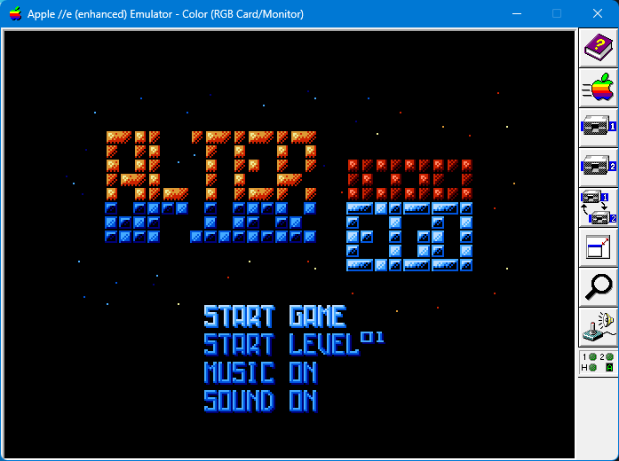
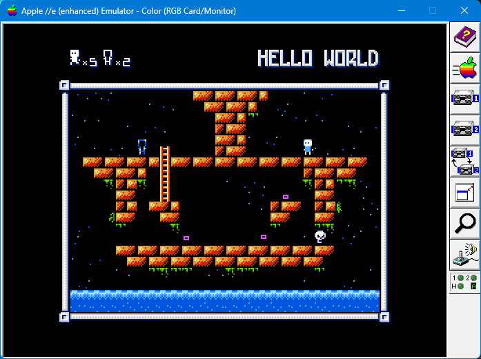
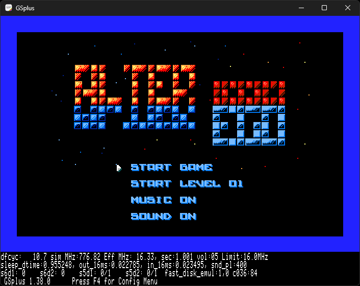
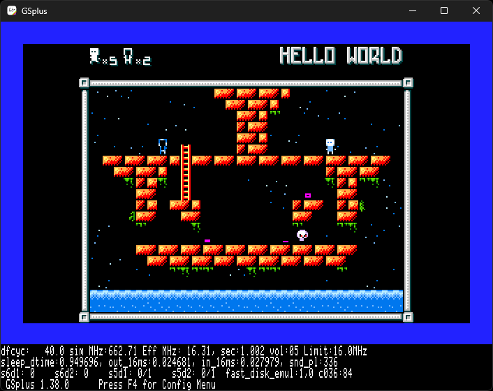
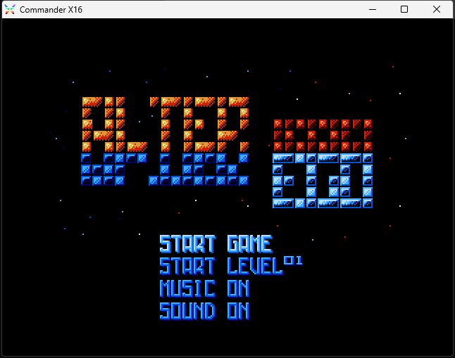
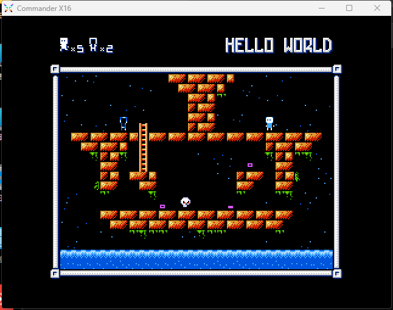
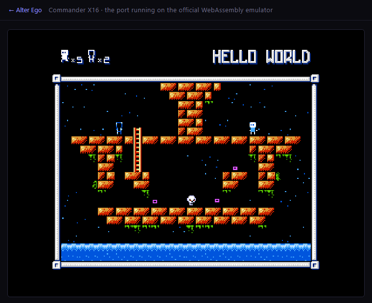

# Alter Ego — NES source, Apple II and Commander X16 ports, browser players

This is a working fork of [avshabanov/alter-ego](https://github.com/avshabanov/alter-ego), the NES
homebrew game Alter Ego.  The repository root mirrors upstream — the same `Makefile`, `src/`,
`LICENSE` and `.gitignore` — and every port lives in its own subdirectory; `README.md` is the only
root file that differs from upstream.

| Directory | What it is | Deliverable |
| --- | --- | --- |
| root | upstream NES sources: `src/`, `Makefile` | the NES ROM, built by [`web/nes/build-rom.mjs`](web/nes/build-rom.mjs) |
| [`vera/`](vera/) | Apple II / II+ / IIe with a VERA card (cc65, NMOS 6502) | `vera/build/alter-ego-vera.hdv` (FamiTone, default), `vera/build/alter-ego-vera-psg.hdv` (streamed PSG), and the FamiTone dual-floppy `-D1.po` / `-D2.po` pair |
| [`iigs/`](iigs/) | Apple IIgs through silky-gs (65816) | [`iigs/build/AlterEgo.2mg`](iigs/build/AlterEgo.2mg) |
| [`web/nes/`](web/nes/) | jsnes browser player for the original NES game | [`web/nes/index.html`](web/nes/index.html) — compiles the ROM from `src/`, so no binary is shipped; published to GitHub Pages by [`.github/workflows/deploy-web.yml`](.github/workflows/deploy-web.yml) |
| [`x16/`](x16/) | Commander X16 (65C02S + VERA, cc65 `-t cx16`) | `x16/spike/dist/` — boot `LOADER.PRG` from that directory |
| [`web/x16/`](web/x16/) | Commander X16 browser player | [`web/x16/index.html`](web/x16/index.html) — loads `x16/spike/dist/` into the official X16Community WebAssembly emulator (fetched and checksum-checked when the site is built) |

Play in a browser — every target has a page:

| Target | Play | What runs there |
| --- | --- | --- |
| NES (original) | 👉 [PLAY HERE](https://anomixer.github.io/alter-ego/nes/index.html) | the jsnes page in [`web/nes/`](web/nes/), playing the ROM compiled from `src/` when the site was built |
| Apple IIgs | 👉 [PLAY HERE](https://a2gsemu-ia.pages.dev/?lang=en&game=https%3A%2F%2Fgithub.com%2Fanomixer%2Falter-ego) | a2gsemu-ia booting the released 800 KiB disk (tag `iigs-v0.0.2`); `Q`, then `Y`, leaves the game on its exit screen |
| Apple //e + VERA | 👉 [PLAY HERE](https://apple2ts.com/?slot2=vera&tab=vera#https://raw.githubusercontent.com/anomixer/alter-ego/master/vera/build/alter-ego-vera.hdv) | Apple2TS streaming [`vera/build/alter-ego-vera.hdv`](vera/build/alter-ego-vera.hdv) from this repository |
| Commander X16 | 👉 [PLAY HERE](https://anomixer.github.io/alter-ego/x16/index.html) | the X16 build on the official X16Community r49 WebAssembly emulator: `LOADER.PRG` plus the 26 level files from `x16/spike/dist/` are copied into its virtual drive; the emulator release itself is downloaded and checksum-checked at build time, not vendored |


The repository was called `alter-ego-vera` while VERA was the only target; it is now plain
`alter-ego`.  Release images keep their `alter-ego-vera*` filenames — those are artifact names, not
the repository name — and the VERA regression scripts under `vera/tools/` still expect the checkout at
`C:\dev\alter-ego`, which is now its actual location.

`make all` at the root is upstream's own NES build.  With a current cc65 (2.19) it needs two changes
that are *not* made to the upstream files: `src/nes.cfg` still uses the pre-2.19 `SYMBOLS` form and the
checked-in `src/nes.lib` predates the current library data version.  [`web/nes/build-rom.mjs`](web/nes/build-rom.mjs)
runs the same five steps with a derived config and the installed library, so it builds the ROM here;
see [`web/nes/README.md`](web/nes/README.md).





## Build and run — VERA

The Apple IIgs port is described in [Apple IIgs port](#apple-iigs-port-silky-gs) below; its full
build notes are in [`iigs/README.md`](iigs/README.md).

The image builder and packer are kept in this repository. It bundles the Cadius
Windows executable, the Applesoft BASIC compiler, the PSG stream
validator, the ProDOS 2.4.3 boot image, the assembly include used by this port,
and the converted music/effect streams. No sibling `veratest` or `veramusic`
checkout is needed.

Building still requires Python 3, Node.js, and the cc65 toolchain (compiler,
assembler, linker, Apple II headers and libraries). Put `cc65.exe` on `PATH` or
set `CC65_BIN` to cc65's `bin` directory. FamiStudio and
`C:\dev\veramusic\tools\ftmplay.exe` are only needed when regenerating the
checked-in music streams; set `FAMISTUDIO` and `FTMPLAY` to their executable
paths when running `vera/tools/famitone2vera_psg.mjs` manually.

Supported machines are Apple II Plus and newer compatible Apple II models
with expansion slots, including enhanced Apple IIe. An Apple II+ needs 48 KB
plus a 16 KB Slot 0 Language Card. VERA can be installed in Slot 2 or Slot 4;
startup detects the slot and runs its matching game and music binary. The build
targets the NMOS 6502 through cc65's `apple2` target and library. The game uses the
Apple II's main RAM and VERA's own VRAM; it does not use the IIe's auxiliary
64 KB RAM. It provides 320x240 tile/sprite graphics and VERA PSG.
The default FamiTone build creates the bootable image
`vera/build/alter-ego-vera.hdv` (800 KB ProDOS, volume `ALTER.EGO`). It
contains all 26 source levels, title/game-over/ending art, ten background
songs and 15 converted NES effects. DHGR/Mockingboard was explored and closed:
preserving the NES screen detail required remaking art and text, so VERA is the
only Apple II graphics/audio target. The FTM build also has a dual 140 KB
floppy release below.
The PSG disk's startup title identifies it with `PSG VER` at the right edge.

Both HDVs are ordinary 800 KB ProDOS volumes containing the game as files.
For a file-level install, copy the complete contents of the chosen HDV volume
to the root of another ProDOS volume, then boot that volume and run `STARTUP`.
Keep each version's files together on the same volume: PSG includes its `.PSG`
tracks and `SFXBANK`, while FTM includes its music overlays and FamiTone data.

### FTM and PSG versions

| | Live FTM (default) | Streamed PSG (opt-in) |
|---|---|---|
| Choose when | You want compact, live playback of the original NES FamiTone song data and steady music during play | NES sound fidelity and 60 Hz visual updates matter most |
| Music | Original FamiTone song data decoded by the 6502 and played through VERA PSG | Converted `.PSG` event streams played from VERA VRAM |
| Effects | Original FamiTone effects resident in RAM | Converted `SFXBANK` effects cached in VERA VRAM |
| Gameplay timing | About 40 display iterations/s; logic alternates 2 and 1 NES steps per iteration to approach 60 steps/s | About 60 display and logic iterations/s |
| Loading | Music pauses while a level is read and drawn, then resumes or starts the next theme | Music pauses while a level is read and drawn, then resumes or starts the next theme |
| 800 KB HDV | `alter-ego-vera.hdv`: 40 files, 438 blocks used | `alter-ego-vera-psg.hdv`: 51 files, 617 blocks used |
| 140 KB floppy release | Two disks, D1 and D2 | No floppy release |

Both versions contain the same levels, graphics, and controls. PSG is the
choice for sound closest to the NES; FTM plays the original FamiTone modules
live for compact, steady music. Normal gameplay audio playback uses resident
RAM or VERA VRAM and does not read the disk. FTM's live decoding costs CPU
time, as reflected in the display rates above.

Both release images here were rebuilt on 2026-11-03 and boot-checked in
AppleWin 1.32 (`-model apple2ee -s2 vera`): each one reaches its STARTUP
screen, the title menu, and Level 1 (HELLO WORLD, five reserves, two
exchanges) after Space. The `PSG VER` marker appears only on the PSG STARTUP
screen; the FTM image's STARTUP line reads `ALTER EGO FOR APPLE II VERA`.

```powershell
iex (Get-Content -Raw vera/build/build_a2vera.ps1)
$appleWin = '<path-to-AppleWin-VERA-fork>\AppleWin.exe'
$image = (Resolve-Path 'vera/build/alter-ego-vera.hdv').Path
Start-Process $appleWin -ArgumentList @('-h1', $image, '-s6', 'empty', '-s7', 'hdc', '-model', 'apple2ee', '-s2', 'vera', '-no-full-screen', '-power-on')
```

To test a Slot 4 card in AppleWin, replace `-s2 vera` with `-s4 vera`.

### Streamed PSG build

The default image above plays the original FamiTone v1.24 song data directly
through VERA's PSG. The streamed `.PSG` variant is built by setting one
variable:

```powershell
$env:CC65_BIN='C:\dev\cc65\bin'
$env:AE2VERA_PSG_BUILD='1'
iex (Get-Content -Raw vera/build/build_a2vera.ps1)
```

This creates `vera/build/alter-ego-vera-psg.hdv`; the FamiTone image keeps the
unsuffixed `alter-ego-vera.hdv` name and is what the command builds when the
variable is unset (`AE2VERA_FTM_BUILD=1` still forces FamiTone for older
commands). The PSG image carries the ten converted `.PSG` songs and the 15
converted effects, so it needs those files on the volume and uses more space.
Its STARTUP title prints `PSG VER` at the right edge; the FamiTone title does
not. Both versions are playable and have been confirmed by the user.
Cadius reports 438 disk blocks used versus 617 in
the PSG image, freeing 179 blocks (91,648 bytes allocated) and removing 11
files. AppleWin has reached the title and Level 1 on this image. The live
player's first Level 1 chord now writes the expected 330 Hz and 196 Hz pulse
tones plus a 263 Hz triangle tone. A ProDOS buffer collision that erased some
pitch entries was fixed; the game music clock was also brought close to the
source's 60 Hz rate. The buffer now occupies `$0C00-$0FFF`; the old `$8400`
buffer overlapped the phase table at `$8500`. AppleWin timing traces show
Level 1 beat intervals typically around 0.33-0.36 seconds, close to the
0.333-second source interval. The FTM title module uses its original seven-tick
row speed at one source tick per 60 Hz VSYNC. Its envelope interpreter runs in
6502 assembly, leaving enough CPU time for roughly 40 display iterations per
second in Level 1.
Gameplay logic and SFX advance alternately one or two NES frames per iteration:
AppleWin measured 185 logic frames in three seconds at idle and 63 in one
second while moving. A completed fall waits for its landing cell's item check
before accepting a new horizontal move. Level music advances alternately one or
two source ticks
per iteration; title music and sound-test BGM 00 advance one source tick per
display iteration, matching the original FamiTone clock. The title tempo was
confirmed by listening in AppleWin. FamiTone SFX repeat lengths and initial
pulse/noise control values are also corrected. In the T sound-test menu, BGM 0
uses the title playback path;
other BGM uses one FamiTone tick per VSYNC. Gameplay keeps its separate tempo
compensation. Both builds use the original game's Level 2 Alt arrangement:
the PSG image selects `LEVEL2ALT.PSG`, while the FTM image uses its native
second level module. Its native directory duplicates that module at index 3,
so FTM gameplay selects indices 1, 2, 4, 5, 6 for the five level themes.
Both sound tests list BGM 00-07. FTM skips the duplicate Level 2 directory
slot; BGM 02 is the formal Level 2 theme and BGM 07 is the ending. The FTM
image builds successfully and has been accepted in gameplay and listening tests.
The title theme now loops from the beginning after its ending note tail, with
the former long terminal silence removed.
Details and memory map are in
[`vera/docs/FAMITONE-VERA-PSG.md`](vera/docs/FAMITONE-VERA-PSG.md).

In both PSG and FTM builds, music is deliberately silent while a level is
read and drawn. A continuing theme resumes from the same position after the
scene appears; a changed theme begins then. Loading can still create a brief
pause between songs. Playback remains steady during normal gameplay.

### Dual 5.25-inch FTM disks

The FTM version also builds as two 140 KB ProDOS floppy images:
`vera/build/alter-ego-vera-D1.po` (`ALTER.EGO`) and
`vera/build/alter-ego-vera-D2.po` (`ALTER.EGO.2`). D1 holds ProDOS,
startup, both Slot 2/4 binaries, and the resident FamiTone player/data. D2
holds all 26 levels, graphics files, and a startup-check marker. Before
launching the game, STARTUP checks D2 and displays
`PLEASE INSERT DISK 2 IN DRIVE 2` if it is missing. Press a key after
inserting D2 to retry. Mount D1 in Drive 1 and D2 in Drive 2 of the same Disk
II controller, then boot D1. The floppy startup loads the matching VERA-slot
binary from D1 and sets the ProDOS prefix to D2 before the game opens its
assets. Both disks are required; use the HDV for a single-volume install.

To rebuild the floppy pair alongside the FTM HDV:

```powershell
$env:CC65_BIN='C:\dev\cc65\bin'
$env:AE2VERA_FTM_FLOPPY='1'
iex (Get-Content -Raw vera/build/build_a2vera.ps1)
```

For AppleWin, mount both images as Disk II drives:

```powershell
$d1=(Resolve-Path 'vera/build/alter-ego-vera-D1.po').Path
$d2=(Resolve-Path 'vera/build/alter-ego-vera-D2.po').Path
Start-Process '<path-to-AppleWin-VERA-fork>\AppleWin.exe' -ArgumentList @(
  '-d1',$d1,'-d2',$d2,'-s6','diskii','-s7','empty',
  '-model','apple2ee','-s2','vera','-no-full-screen','-power-on')
```

AppleWin booted the pair with Slot 2 VERA through Title and Level 1, and with
Slot 4 VERA into a playable level. Both volumes pass `CHECKVOLUME`; D1 has 79
free blocks and D2 has 34. The pair uses the same FTM game binaries as the HDV.

At boot, `STARTUP.BAS` checks for the VERA card and shows
`BY ANOMIXER https://github.com/anomixer`, the keyboard/joystick controls
(including `M` for music mute and `N` for sound mute), and
the `HIT ANY KEY OR WAIT 5 SECS TO START...` prompt. Press any key to continue,
or wait five seconds.
Stop AppleWin before rebuilding; the build script does this automatically.
Intermediate files under `build/` are ignored by Git. The FTM HDV and two
floppy images are tracked release artifacts; the build script is tracked too.

Cold boot shows the original Credits shifted upward, followed by the added
`APPLE II VERA CONVERSION BY` / `ANOMIXER 2026` signature. After 2.5 seconds it
continues to the title; Space or joystick button 2 skips the intro. Title music
starts at the title. The PSG HDV contains 51 files and the FTM HDV 40; the
floppy pair stores 7 files on D1 and 34 on D2, including the D2 startup marker.

| Input | Action |
|---|---|
| WASD / arrow keys / joystick | Move/climb |
| J / K / joystick button 1 | Exchange Egos |
| Space / joystick button 2 | Start/pause; confirm Resume or Restart |
| W / S / Up / Down / joystick while paused | Choose menu entry |
| Left / Right on title | Change selected level, or toggle selected audio option |
| Space on title | Start selected game/level, or toggle selected audio option |
| G | Detect a joystick connected or enabled after boot |
| M | Toggle background music mute (game effects remain audible) |
| N | Toggle game sound effects (background music remains audible) |
| 1 on title | Select hidden cow level |
| T on title | Sound Test (shows SFX NN / BGM N): WASD selects, K plays, J stops, M/N toggle audio and update the title labels, T or Esc exits |

The joystick uses the Apple II game port (PDL0/PDL1 and two buttons), with a
centre dead zone and one Start/pause event per press. A disconnected controller
is ignored. In AppleWin, configure **Joystick 1** in the Input settings for
your PC joystick/gamepad, or NumPad for keyboard joystick emulation. NumPad
4/6/8/2 are directions, 0 is button 1, and decimal is button 2. The game reads
the emulated Apple II port; a USB gamepad must be mapped by AppleWin.

Apple II+ keyboards do not report key release, so a direction continues moving
after one press until another key is pressed (or a level reload resets input).
This is a hardware limitation; enhanced Apple IIe keyboards report held state,
so movement stops when the key is released.

The source title code `K, A, J, K, A, J` enables Select (`1`) level skipping.
Restart spends a reserve; zero reserves still permits the current final life.
The title menu lists START GAME, START LEVEL, MUSIC ON/OFF, and SOUND ON/OFF
with equal vertical spacing and left-aligned labels. Left/Right or Space on an
audio row toggles that setting and updates its ON/OFF label immediately.
Pause offers Resume,
Restart (while reserves remain), and Exit Game; with zero reserves it offers
Resume and Exit Game.

### Verification

Actual AppleWin runs have loaded all 26 levels and reached the ending using
Select skips, with snapshot checks for maps, CHR banks, intact program memory,
unused sprites and pause state. A normal Level 1 solution collected both item
kinds and advanced to Level 2 without cheats. The clear message now erases the
whole two-row level name, including its rightmost letters.

The FTM build checks item pickup at every eight-pixel fall boundary, including
the boundary between two NES logic steps in one display iteration. AppleWin
regression tests collected the falling item stacks in Levels 7 and 10; the
same boundary check accepts an exchange during Level 24's rightward fall.
The Level 7 test cleared the stage and advanced to Level 8.

Title navigation updates only the palette attributes of the old and new menu
rows; it redraws text only when its value changes. The pause menu redraws its
sprites only when the cursor moves or blinks, and the paused FTM player skips
its per-frame music-register writes. AppleWin measured 60.5 title iterations/s
idle, 60.1 while navigating, and 60.7 pause iterations/s. The FTM menu and
Level 7 regressions, and the PSG menu regression, passed after the change.

Level loading hides the display layers while replacing the map and palette,
then restores them with the palette already at its fade-in starting brightness
to avoid a bright-to-dark flash.

Assembly OAM reduced rendering cost; one measured run reached 59.59 updates
per second. Song data is cached in VERA VRAM, so normal music playback does
not read the disk. When a level clear will change tracks, the next song is
prefetched in 256-byte chunks during the clear sequence and becomes available
immediately at the transition. The PSG build incrementally loads the fixed-slot
SFXBANK into free VERA VRAM ($E000-$F67F) on the title screen. Starting or
playing an effect then reads only VRAM and writes VERA voices 4 and 5; there
are no ProDOS reads in the gameplay SFX path. Changing the Start Level number
does not read its BGM; after Start is confirmed, the selected song is prefetched
during the start transition. During play, a level-clear transition reads
the next BGM in bounded 256-byte chunks. A brief pause may occur while a level
is loaded and its BGM is made ready. Once play is underway, normal music and
SFX playback use VERA VRAM without disk access, so audio does not stall the
gameplay loop. If music stays muted through level entry, turning it back on may
load the requested song and briefly pause. Sound effects advance once per game
frame at the measured ~60 Hz cadence. Pause resumes music at its previous
position.
The latest SFX conversion raises effect 9 and corrects the noise pitch and
duration for effects 11 and 12; please check those entries in the T sound test.
Music conversion uses FamiStudio WAV stems for the tonal voices and volume
envelopes, while noise pitch follows each FTM note's NES APU period. The same
PSG streams play in `psgplay` and in the game. Conversion doubles the
per-voice amplitude through VERA's logarithmic volume table (about +6 dB,
capped at the hardware limit); an offline Level 1 render measured +3.1 dB RMS
overall. Game sound effects use paired PSG voices for about +6 dB.
Full NES differential playthrough is still required before claiming 100% parity.

Tools and runtime notes are described in [vera/AGENTS.md](vera/AGENTS.md) and
[the runtime notes](vera/docs/APPLE2-REWRITE.md). AppleWin regression scripts write
temporary captures under `vera/build/shots`. Run them with
`iex (Get-Content -Raw vera/tools/a2vera_smoke.ps1)` or
`iex (Get-Content -Raw vera/tools/a2vera_gameplay_test.ps1)`.

## Apple IIgs port (silky-gs)

The same game also runs on the Apple IIgs through
[silky-gs](https://github.com/lscharen/iigs-game-engine), a native 65816 NES runtime: the NES program
executes as a coroutine next to the GS task, and its PPU/APU traffic is translated to Super Hi-Res
graphics and DOC audio.  It is not an emulator, and no VERA card is involved.  The port reuses the
original 32 KB NES program, the original FamiTone2 music/SFX data and the NES level data; the 65816
side supplies the screen, the palette pipeline and the audio mixing.

- **Download:** tag [`iigs-v0.0.2`](https://github.com/anomixer/alter-ego/releases/tag/iigs-v0.0.2)
  carries the two disks below as release assets — `AlterEgo.2mg` (819,264 bytes,
  SHA256 `4115CB7F…`) and `AlterEgo-full.2mg` (3,670,080 bytes, SHA256 `3D7EA71E…`), byte for byte
  the tracked files in `iigs/build/`.
- **Boot image:** [`iigs/build/AlterEgo.2mg`](iigs/build/AlterEgo.2mg) — a GS/OS boot disk (an
  819,264-byte `.2mg`: a 64-byte 2IMG header plus 1,600 blocks = 800 KiB), volume `ALTEREGO`, that
  boots straight into the game:
  GS/OS starts `/SYSTEM/START`, which is the 316,161-byte program built from `iigs/`.  `npm run
  make:boot` rebuilds it from the silky-gs minimal boot set, so the disk holds ProDOS 8, the GS/OS
  files it needs and the game, and nothing else (495 blocks free).  The full System 6 version is
  [`iigs/build/AlterEgo-full.2mg`](iigs/build/AlterEgo-full.2mg) — 3,670,080 bytes, trimmed down from
  the 10 MB volume, with the Finder desktop and the game as `/ALTEREGO/AlterEgoGS.S16`.  The source of
  the program is `iigs/`; see [`iigs/README.md`](iigs/README.md) and [`iigs/AGENTS.md`](iigs/AGENTS.md).
- **Screen:** 320×200 Super Hi-Res.  The 256×200 playfield is centred at `x_offset=16` and maps NES
  scanlines 16–215; the title and credits are full-screen NES content.  Gameplay uses the engine's
  dirty-grid renderer, so only changed background cells and sprites are drawn each frame.
- **Audio:** the original FamiTone2 driver and song data, mixed by the engine at 60 Hz (60/120/240 Hz
  is selectable in the silky-gs panel) and played by the IIgs DOC.  `MUSIC OFF` silences gameplay and
  ending music as well as the title theme.
- **Speed:** released for a **16 MHz** machine — that is the baseline the captures, the checked-in
  GSplus configuration and `npm run test` use, and the title comes up in about 20 seconds.  A stock
  **2.8 MHz** IIgs runs it too: a full gameplay render still fits inside one VBL and the sea keeps its
  original 16-frame animation cadence (about 30 fps), at the cost of a 2–3 minute boot.  An
  accelerator in between (a TransWarp GS at 7.1 MHz) sits proportionally between the two — the
  renderer's per-frame cost is fixed, so smoothness scales roughly with the clock.
- **Raw `.po` (optional, not part of the release):** `npm run make:po` in `iigs/` derives
  `iigs/build/AlterEgo.po` — the same **800 KiB** ProDOS 8 volume (1,600 blocks) with the 2IMG header
  stripped — for emulators that take a bare ProDOS-order image.  It is generated and not committed;
  the release ships the two `.2mg` files.
- **NES program:** `iigs/src/games/alterego/prg.bin` must stay exactly 32,768 bytes.  The shipped
  file is reproduced byte for byte from the objects kept in [`iigs/prg-src/`](iigs/prg-src/README.md)
  (SHA256 `C4CB0445…`), so a PRG change is rebuilt there with cc65 and relinked before the Merlin
  build.





Run it in GSplus with the checked-in configuration:

```powershell
Start-Process C:\dev\emu\GSplus\gsplus.exe `
  -ArgumentList '-cfg', (Resolve-Path iigs\emu\gsplus-alterego.kegs).Path
```

Click the GSplus window, wait for the title, then press **Return**; inputs sent before the title
appears are lost.  The `.kegs` file's `s7d1` entry points at `iigs/build/AlterEgo.2mg`, so it follows
this checkout as long as the repository stays at `C:\dev\alter-ego` (edit `s7d1` if it moves).
Rebuilding the application needs Node.js, Merlin32 and Cadius; `npm run make:boot` then rebuilds the
800 KiB boot disk, building its own copy of the game (`build/AlterEgoGS.exit`, which ends the game on
Q with a "safe to turn off" screen)
so the disk is never packed with a build that quits (swap the application into the full volume with
Cadius `REPLACEFILE` instead, as described in [`iigs/README.md`](iigs/README.md)).  `npm run test` in `iigs/` boots the
committed image in GSplus and asserts that the title and Level 1 screens actually drew (pixel checks
on GSplus' own screenshots), so a rendering regression fails the run instead of only being noticed by
eye.

| Input | Action |
|---|---|
| Arrow keys | Move/climb, and choose menu lines |
| Z / Space | NES A; in the sound test, Space auditions the selected SFX/BGM |
| X | NES B |
| Return / P | Start, pause, confirm |
| Tab | NES Select; opens and closes the sound test on the title |
| Left / Right on title | Change the START LEVEL value (0–25; 0 is the hidden Cow Level) |
| ? (Shift-/) | Open the silky-gs options panel (audio, input, drivers, credits) |
| Q | Quit, after a Y/N confirmation: on the 800 KiB boot disk it saves the settings, leaves a “game has exited — safe to turn off” screen and stops (only the reset button starts the machine again; that disk has no Finder); on the full System 6 disk it returns to the Finder |

The title menu, sound test, pause menu and Cow Level work as in the VERA build, with two exceptions
forced by the one-key-at-a-time keyboard shim: the NES key chords cannot be typed, so the A+B
sound-test chord and the `K, A, J, K, A, J` level unlock are unreachable — use **Tab** for the sound
test and **START LEVEL 00** for the Cow Level.

### Verification

Verified in GSplus: title, credits, sound test, pause menu, Level 1, and the game → pause → EXIT GAME
→ title round trip.  The level-start music hold was checked frame by frame through a level start: the
music stays on LEVEL CLEAR, is silent from the black load screen through the READY blink, and resumes
on the frame the ego becomes controllable.  A full play-through from boot to the ending on 2026-11-01
ran normally (the player's report, not an automated check), so the later levels, LEVEL CLEAR and the
WELL DONE ending are exercised in practice; the repository still has no screenshots of those screens
or of GAME OVER.  The dated log, engine constraints and open items are in
[`iigs/AGENTS.md`](iigs/AGENTS.md).

## Commander X16 port

The same game sources ported to the Commander X16 with cc65's `-t cx16` target.
[`x16/README.md`](x16/README.md) covers the build, the KERNAL LOAD boot chain,
the controls and the memory budget (the Traditional Chinese original is
[`x16/readme-tw.md`](x16/readme-tw.md)); [`x16/docs/PORT-CX16-EVAL.md`](x16/docs/PORT-CX16-EVAL.md)
is the platform study and the per-fix evidence log.

- Playable in x16emu (r49): title menu, all 26 level files (`LV00`–`LV25`), the
  exchange, the in-game pause menu, the `T`/`M`/`N`/`1` keys, credits and the
  ending screen.  `LV01`, `LV03` and `LV24` were driven end-to-end by the
  automation script; the other levels share the same `load_level_file()`.
- The shipped build is `x16/spike/dist/` (`GAME` 29,698 B, the `MUSIC` overlay,
  `LOADER.PRG` and the level/asset files):

```
x16emu -prg x16/spike/dist/LOADER.PRG -run -fsroot x16/spike/dist -scale 2
```

- In the browser: <https://anomixer.github.io/alter-ego/x16/index.html> boots the same files on
  the official X16Community r49 WebAssembly emulator.  [`web/x16/`](web/x16/) holds the page
  and [`web/x16/assemble.mjs`](web/x16/assemble.mjs) downloads the pinned emulator archive
  (SHA-256 checked) and copies the lower-case game files plus a `manifest.json` into the
  site, so the published page runs the same `x16/spike/dist/` build.
- Three gameplay bugs only showed up on the X16: the mid-air exchange had to be
  checked every frame (was one tile boundary in eight), a swap had to snap the
  Ego to its landing row, and vertically mirrored levels may only swap where the
  mirror spot has a floor.  The last check did not fit in the game's RAM area, so
  it is hand-written asm in [`x16/spike/gate_cx16.s`](x16/spike/gate_cx16.s),
  placed in the free hole at `$92DC`.
- The Apple II VERA image is untouched by this port: every behavioural change is
  inside `#ifdef VERA_X16` and `vera/build/` still ships the same images.







## Play the NES original in a browser

👉 **[PLAY HERE](https://anomixer.github.io/alter-ego/nes/index.html)** — the page is published to
GitHub Pages by [`.github/workflows/deploy-web.yml`](.github/workflows/deploy-web.yml), the site root
is [`web/index.html`](web/index.html) and the player is `nes/index.html` under it.  Nothing has to be
committed to make that work: the workflow installs cc65, compiles `src/`, smoke-tests the ROM and
uploads `web/_site`.

[`web/nes/index.html`](web/nes/index.html) plays the original NES game through
[jsnes](https://github.com/bfirsh/jsnes) 2.1.0 (Apache-2.0, vendored in `web/nes/vendor/`).  It is one
static page — open the file directly or serve the directory — and the ROM it plays is compiled from
this repository's `src/` and embedded as base64, so the page also works from `file://`:

```powershell
cd web\nes
node build-rom.mjs     # cc65/ca65/ld65 -> build/alterego.nes + build/rom-base64.js
node test.mjs          # headless jsnes smoke test (title -> Start -> Level 1), PASS/FAIL
node ..\build-site.mjs # web/_site: the landing page plus nes/, as the workflow publishes it
```

`build-site.mjs` copies the tracked page files and the generated `build/` files into `web/_site`
(gitignored) and fails if a page references a file that is not there.

The ROM (40,976 bytes: 32 KB PRG + 8 KB CHR, mapper 0) is generated and gitignored, so no binary is
committed; `build-rom.mjs --from <file.nes>` stages an existing ROM instead.  Measured on the
source-built ROM: title at 252 frames, Level 1 92 frames after the Start press, `PASS`.  The smoke
test writes `web/nes/build/shots/title.png` and `level1.png`.  Page controls: arrows, `X` = A and `Z` =
B (exchange), `Enter`/`Space` = START, `Ctrl` = SELECT, `R` reset, `F` fullscreen, numeric-keypad
`7`/`9`/`1`/`3` for A/B/START/SELECT, and the same pad is on screen under the bar for touch and mouse.
The bar has Reset / Pause / Mute / Volume / Fullscreen / Load another .nes; any `.nes` file can be
dropped on the page or opened with its file button.  The page itself is in English.  Reset boots the
ROM again (jsnes' own `nes.reset()` left the mapper stale and wedged the game), `F` gives a real
fullscreen, and the canvas always fills the 256:240 stage — no black band on the right.

Two input quirks are handled in `app.js`.  Keys are mapped from `event.code`, not jsnes' `keyCode`
table, so a Chinese IME (which reports letters as keyCode 229) cannot swallow `X`/`Z`; and because the
IME also eats their *keyup*, action buttons act as taps and release themselves 400 ms after going down
-- a stuck A button made the ROM refuse every later exchange, with the exchange counter untouched.
`window.__ae` in the console reports the last key, the held buttons and the ROM's two HUD counters
(`hud.exchange` is the number of swaps a level still allows: level 1 gives two).

The first click both starts the game and unlocks audio (the browser's autoplay rule).  Sound is driven
by `web/nes/audio.js`, not by jsnes' own output: jsnes plays through an `AudioWorklet` that Chrome does
not load at all from `file://`, which used to leave the page silent with no error.  The status line
shows the measured path (`Sound: 90% (44100 Hz→48000 Hz)`).  Cold boot opens on the original NES credits
screen, which is English, as on the cartridge; Space skips it.

## Documentation

Design records and notes, grouped by port.

**Browser players**

- [`web/nes/README.md`](web/nes/README.md) — the jsnes page: layout, its self-driven audio path, the headless smoke test and the Pages deployment.
- [`web/build-site.mjs`](web/build-site.mjs) — assembles `web/_site` (landing page plus `nes/`) and refuses to publish a page whose local references are missing.
- [`.github/workflows/deploy-web.yml`](.github/workflows/deploy-web.yml) — installs cc65, compiles and smoke-tests the ROM, then publishes the site.

**Apple IIgs / silky-gs**

- [`iigs/README.md`](iigs/README.md) — the port itself: repository layout, build, GSplus run, controls
  and current status.
- [`iigs/AGENTS.md`](iigs/AGENTS.md) — dated work log, engine constraints and the open items.
- [`iigs/docs/PORT-IIGS-SILKY-EVAL.md`](iigs/docs/PORT-IIGS-SILKY-EVAL.md) — the feasibility study that started
  the port (in Chinese): NES PPU/APU measured against Super Hi-Res and the DOC, the 320×200 layout,
  tile/sprite budgets and the limits of the silky-gs runtime.
- [`iigs/docs/PORT-IIGS-TITLE-POC.md`](iigs/docs/PORT-IIGS-TITLE-POC.md) — the title-screen proof of concept:
  what already rendered, the black-screen root cause, and the `prg.bin` recipe that survived it.
- [`iigs/prg-src/README.md`](iigs/prg-src/README.md) — the cc65 staging tree that rebuilds the shipped
  NES program byte for byte.

**Apple II / VERA**

- [`vera/docs/PORT-APPLE2-EVAL.md`](vera/docs/PORT-APPLE2-EVAL.md) — the earlier Apple II feasibility study
  (in Chinese), including the `//e` DHGR direction that was closed.
- [`vera/docs/APPLE2-REWRITE.md`](vera/docs/APPLE2-REWRITE.md) — VERA runtime notes.
- [`vera/docs/FAMITONE-VERA-PSG.md`](vera/docs/FAMITONE-VERA-PSG.md) — FamiTone → VERA PSG player and timing
  details.
- [`vera/docs/archive/apple2e/`](vera/docs/archive/apple2e/) — archived `//e` material; see
  [`IMPORT-NOTES.md`](vera/docs/archive/apple2e/IMPORT-NOTES.md) for what was dropped.

**Porting guides**

- [`x16/docs/A2VERA-to-CX16.md`](x16/docs/A2VERA-to-CX16.md) — the working guide for porting another
  a2vera game (next up: freegemas): what transfers, the KERNAL LOAD asset layer and its lower-case
  HostFS rule, the `$0801` boot chain, the input layer, the VSYNC cadence trap, a symptom → cause
  table and a pre-flight checklist.
- [`x16/docs/A2VERA-to-CX16-tw.md`](x16/docs/A2VERA-to-CX16-tw.md) — the same guide in Traditional
  Chinese.

**Commander X16**

- [`x16/README.md`](x16/README.md) — the port: build, boot chain, controls, the mid-air exchange fixes and
  the memory budget.
- [`x16/readme-tw.md`](x16/readme-tw.md) — the same document in Traditional Chinese (the original the
  English README was translated from).
- [`x16/docs/PORT-CX16-EVAL.md`](x16/docs/PORT-CX16-EVAL.md) — the evaluation report: VERA/NES comparison,
  reuse list, probe evidence, the per-fix verification log and the browser build.
- [`x16/docs/PORT-CX16-EVAL-tw.md`](x16/docs/PORT-CX16-EVAL-tw.md) — the same report in Traditional Chinese
  (the original it was translated from).

## Credits

* [Pouët production page](https://www.pouet.net/prod.php?which=71667)
* [ZX Spectrum Alter Ego entry](https://spectrumcomputing.co.uk/entry/26211/ZX-Spectrum/Alter_Ego)
* [Original NES Alter Ego source](https://github.com/avshabanov/alter-ego)

Bundled third-party components and their licenses/provenance are listed in
[vera/THIRD_PARTY_NOTICES.md](vera/THIRD_PARTY_NOTICES.md).

## Links

* [Programming NES games in C](http://shiru.untergrund.net/articles/programming_nes_games_in_c.htm)

