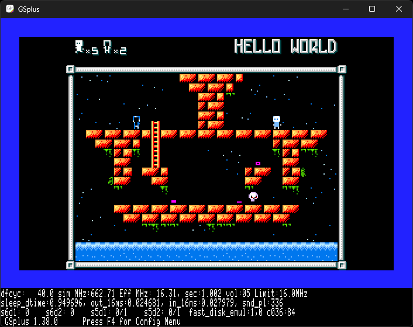
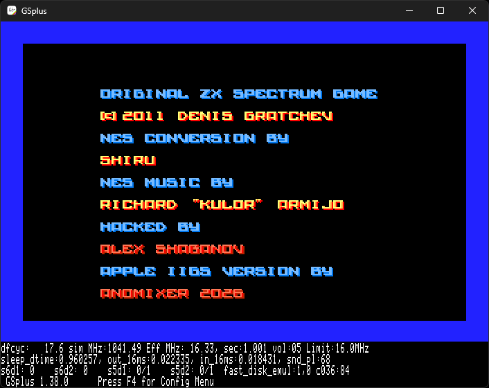
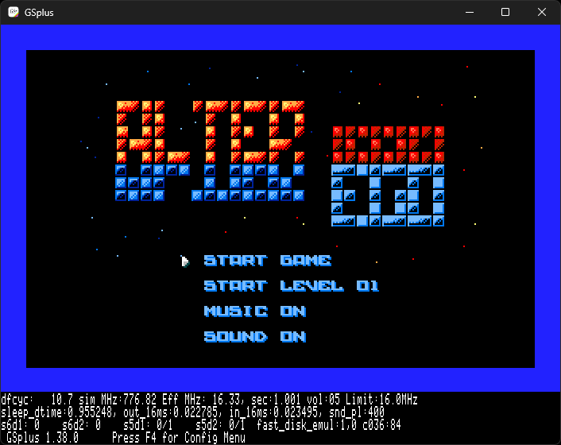
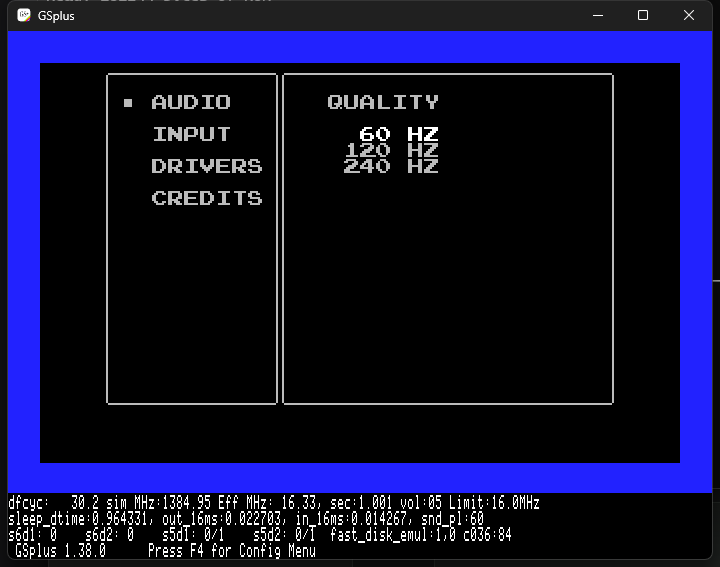

# Alter Ego — Apple IIgs / silky-gs port

This directory is the Apple IIgs work for the cc65 NES homebrew **Alter Ego**, built on
[silky-gs](https://github.com/lscharen/iigs-game-engine) (a native 65816 NES runtime, not an emulator).

This `iigs/` tree sits **alongside** the Apple II VERA port, which now lives in `vera/`; the repository
root itself mirrors upstream `avshabanov/alter-ego` (only `README.md` differs), so neither port edits
the shared NES sources.

It is a snapshot of the working tree that was used to bring Alter Ego up on GSplus, including the
current bootable 3.5" images:

- **Boot image:** [`build/AlterEgo.2mg`](build/AlterEgo.2mg) (800 KiB GS/OS boot disk: the game is
  `/SYSTEM/START`, so it boots straight into the game)
- **Full System 6 image:** [`build/AlterEgo-full.2mg`](build/AlterEgo-full.2mg) (3.5 MB ProDOS 8
  volume with System 6 and the Finder, the game as `/ALTEREGO/AlterEgoGS.S16`)
- **Application:** [`build/AlterEgoGS`](build/AlterEgoGS) (313,359 bytes)
- **Current screen:** 
- **Credits:** 
- **Title:** 
- **Runtime options:** 

## Current status (2026-11-04, branch `master`)

- **Released:** tag
  [`iigs-v0.0.2`](https://github.com/anomixer/alter-ego/releases/tag/iigs-v0.0.2) ships the two disks
  in `build/` — the 800 KiB boot disk and the full System 6 volume (see "Release" below).
- Boots on GSplus; title → level 0 is playable, with music and SFX enabled.
- Playfield is the NES 32×20 tile map at **256×200** displayed inside the 320×200 SHR screen.
- Single gameplay band: SHR lines 0–199 map to NES rows 16–215 (`y_offset=16`).  The HUD stats,
  outer frame and playfield share the same source band; the frame lands flush on the last SHR line
  (no blank rows below it).  Gameplay sprites use compact OAM coordinates (`GRID_COMPACT_SPRITES=1`).
- The credits and title screens are full-screen NES content; they render with a `YOffsetAbs` of 31.
  The title is rendered with `scroll(...,8)`, lifting the ALTER EGO logo one tile; its four menu
  rows are written one tile lower in the nametable so the menu and cursor stay on their original
  screen rows, and the title art keeps its original palette attributes.  The credits block remains
  vertically centred in the 200-line SHR viewport.
- Gameplay uses the dirty-grid renderer (`ENABLE_DIRTY_RENDERING=1`): only changed background cells
  and sprites are emitted each frame.  The HUD activation check uses the `OAM_COPY` first word, not
  `spriteCount`.
- At the factory **2.8 MHz** setting gameplay renders at about **30 fps**.  The game's every-16-frames
  background CHR pattern-table toggle (`bank_bg`) is avoided, because the toggle forced a full-screen
  tile redraw and limited the port to roughly 12 fps.  Instead, the port keeps pattern page 0 and
  copies the page-1 water variants into spare page-0 tiles `$E0–$E3`; every 16 frames it rewrites
  only the water nametable cells with `vram_adr`/`vram_put`.  The sea therefore animates at the
  original cadence while the rest of the playfield stays static and the dirty grid still runs at
  full speed.
- **Speed baseline:** the port is released for a **16 MHz** machine, which is what the checked-in
  GSplus configuration, the `docs/screenshots/` captures and `npm run test` use (boot to title
  ≈ 20 s).  The factory **2.8 MHz** setting is playable — about 30 fps gameplay and a 2–3 minute
  boot — and an accelerator in between (a TransWarp GS at 7.1 MHz) scales with the clock, since the
  renderer's per-frame cost is fixed.
- The core engine is the upstream **silky-gs v0.0.2** tag (`0c341d2`), merged onto the port's
  v0.0.1-based work.  v0.0.2 changes the keyboard layer (BASIC driver only; the J13/ADB drivers are
  compiled out here), reads A/B from the Command/Option push buttons in the configuration screen,
  and suspends/resumes the engine's interrupt handling while the control panel is open.  The port
  keeps its own `yieldFrame`, `YOffsetDyn`/`LayoutActiveDyn` direct-page fields, startup border
  diagnostics, and the `OAM_COPY` HUD probe.
  - Upstream v0.0.2 itself defaults to BASIC (`KBD_J13=0`, `KBD_ADB=0`); J13 and ADB are optional
    flags that also need their source files added to `src/runtime/code.txt` (ADB additionally needs
    `rom_kbd_j13.s`).  This port follows that default.  BASIC is sufficient for Alter Ego's
    one-key-at-a-time `_pad_poll` shim and avoids the ADB driver's known control-panel limitation
    (`ToBRAMSetup` drops its SRQ routine until the panel is closed).
- The title uses the VERA port's four-button menu: **START GAME**, **START LEVEL** (0–25; 0 is the
  hidden Cow Level),
  **MUSIC ON/OFF**, **SOUND ON/OFF**.  The old blinking `PRESS START` prompt is hidden on both
  nametables so the menu is the only title prompt.  The menu is drawn into both nametables, and the
  title's scroll y=8 keeps the renderer on nametable 0 while lifting the logo one tile.
- **Tab** on the title opens the sound test, which reuses row 23 as
  `MUSIC ON  SFX00 BGM00` (`MUSIC OFF` keeps one blank before `SFX`); **Tab** again closes it and
  returns to the menu.  The four counter digits are OAM sprites, as in the original NES build, so
  they stay out of the background's 16×16 attribute blocks.  `palettes/title.txt` sprite row 1
  carries the logo's pale yellow (`$38`) and row 2 repeats the menu's light blue (`$0F,$01,$11,$21`),
  so Left/Right only recolours the selected pair of digits.
- Credits stay on nametable 0.
- Audio is the original FamiTone2 driver and data, routed through the silky-gs APU model.  FamiTone
  is 8-bit code and its APU trampolines start at `$7E30`; both details are required, otherwise the
  status write corrupts the following APU instructions (the old `Emulated state corrupt` crash).
  **MUSIC OFF** on the title menu also suppresses gameplay and ending music, not just the title theme.
- A host loopback capture of GSplus gameplay measured RMS 3532 / peak 27610, confirming that the
  emulator is producing the game's music/SFX, not just running silently.

## Repository layout

The deliverable lives in `iigs/build/`, next to the sources; the VERA port keeps its images in
`vera/build/` the same way, and the repository root keeps the upstream NES tree untouched.

```
iigs/                                     (sources)
  build/                 deliverable: AlterEgo.2mg (bootable image), AlterEgoGS (S16 application)
  src/games/alterego/    Alter Ego port: Main.s, Config.s, Hooks.s, game C/asm, assets, build.js
  src/core/, src/ppu/    silky-gs engine (the runtime this port is built on)
  scripts/               build, palette and image tooling
  prg-src/               NES PRG staging tree (cc65) that rebuilds src/games/alterego/prg.bin
  macros/, src/rom/      shared Merlin32 macros and NES-ROM wrappers
  emu/gsplus-*.kegs      GSplus configuration; s7d1 points at iigs/build/AlterEgo.2mg
  docs/screenshots/      reference captures
  docs/SILKY-GS-UPSTREAM-README.md   upstream silky-gs README
  AGENTS.md              working log, constraints and next steps
  CLAUDE.md              upstream engine guide (kept for reference)
```


## Build

Prerequisites (Windows): Node.js, Merlin32 and Cadius. The tool paths are in `package.json` under
`config`:

- `merlin32`: `C:\dev\Merlin32.exe`
- `cadius`: `C:\dev\cadius.exe`

From the repository root:

```powershell
cd iigs\src\games\alterego
node build.js
```

The build prints the segment sizes and writes `AlterEgoGS` (313,359 bytes). The input
`src/games/alterego/prg.bin` must stay exactly 32,768 bytes.  The committed `prg.bin` is built from
`iigs/prg-src/variants/game_apop1.c` (imported on 2026-11-01 from the archived upstream tree) with the
VERA-style title menu and pause **EXIT GAME** added, the water-only nametable animation folded into the
source (`bank_bg(0)` plus the `$E0–$E3` page-0 wave tiles), and the FamiTone audio driver/objects
linked as before.  The title keeps the original `src/title.h` palette data and lifts the logo with a
scroll of y=8; the last-life pause menu hides RESTART and moves EXIT into its row.  The app build only
consumes `prg.bin`; the current PRG is reproduced byte for byte from the objects kept in
`iigs/prg-src/objects` (`crt0_silky.o`, `neslib_new.o`, `game_fixed.o`, `audio_silky.o`, `nes.lib`):

```powershell
cd iigs\prg-src
ld65 -C nes_silky.cfg -o prg.bin objects\crt0_silky.o objects\neslib_new.o `
  objects\game_fixed.o objects\audio_silky.o C:\dev\cc65\lib\nes.lib
```

`neslib_silky.s` is 65816 code, so reassembling it takes `ca65 --cpu 65816` — the plain 6502 default
rejects `phk`/`plb`.  Re-derive any binary patch from a fresh link if you rebuild the PRG, and see
`iigs/prg-src/README.md` for the full C-side recipe.

## Rebuild the boot image

`build/AlterEgo.2mg` is **generated**, not edited: `dist/GSBoot.2mg` (the silky-gs minimal GS/OS 6
boot disk, itself made by that repository's `scripts/make-boot-disk.js`) is copied, its volume is
renamed `ALTEREGO`, the application is added as `/SYSTEM/START` and `dist/README.TXT` as a ProDOS
text file at the root:

```powershell
cd iigs
npm run make:boot
```

`make:boot` first builds the copy the disk needs: `node build.js --exitscreen` in
`src/games/alterego/` publishes **`build/AlterEgoGS.exit`** (gitignored), which unlike the default
`build/AlterEgoGS` ends the game on **Q → Y** with a screen that says so, instead of quitting to a
Finder this disk does not have.  The flag generates `src/games/alterego/QuitMode.s`
(`QUIT_EXITSCREEN equ 1`) and the quit screen (`QuitScreen.s`) before Merlin runs, so a boot image can
never be packed from a copy that quits — see "Quitting" below.

The script checks the catalogue before it finishes (`Start` must be `S16` in `/SYSTEM`, `README.TXT`
must be a `$B0` file at the root, the volume must still report 1,600 blocks), because Cadius reports
`ADDFILE` failures but exits 0.

The 3.5 MB full image is a plain ProDOS 8 volume, so the application can also be replaced in place
there:

```powershell
New-Item -ItemType Directory tmp\repackage -Force | Out-Null
Copy-Item build\AlterEgoGS 'tmp\repackage\AlterEgoGS.S16#B3DB03' -Force
& C:\dev\cadius.exe REPLACEFILE build\AlterEgo-full.2mg /ALTEREGO 'tmp\repackage\AlterEgoGS.S16#B3DB03'
```

Cadius takes the ProDOS type from the `#B3DB03` suffix: staging the file as plain `AlterEgoGS.S16`
replaces it as `UNK $0000` and the image will not launch.  Use `REPLACEFILE` (not `ADDFILE`) and
confirm with `CATALOG` that the entry still reads `S16 $DB03`.

## Release: `iigs-v0.0.2` — two `.2mg` disks

The port is published as tag **`iigs-v0.0.2`**
(<https://github.com/anomixer/alter-ego/releases/tag/iigs-v0.0.2>), with the two images below as its
assets — byte for byte the files the tag holds, so an asset and a checkout cannot drift.  To try it
without installing an emulator, 👉 **[PLAY HERE](https://a2gsemu-ia.pages.dev/?lang=en&game=https%3A%2F%2Fgithub.com%2Fanomixer%2Falter-ego)**
(a2gsemu-ia boots the released `AlterEgo.2mg` from the repository).  Two images
are tracked in `build/`:

- **`build/AlterEgo.2mg` — 819,264 bytes (a 64-byte 2IMG header plus 1,600 blocks = 800 KiB).**  The
  release image: a minimal GS/OS 6 boot disk (ProDOS 8 + `START.GS.OS` + `GS.OS` + the two drivers,
  two FSTs and the four `System.Setup` files — 478 blocks) with the volume renamed `ALTEREGO`, the
  game as `/SYSTEM/START` (613 blocks) and `README.TXT` (the keys, as a ProDOS text file).  GS/OS
  launches `/SYSTEM/START` at boot, so there is **no Finder and no desktop**: the game comes up by
  itself.  495 blocks (247 KiB) are free.  Built by `npm run make:boot`.
- **`build/AlterEgo-full.2mg` — 3,670,080 bytes (3.5 MB, 7,168 blocks).**  The same game on a full
  System 6 volume (`/ALTEREGO/AlterEgoGS.S16`, started by `Start.Data`), which boots to the Finder
  desktop and works as an ordinary GS/OS disk.  It is the 10 MB volume the port used to ship, trimmed
  as described below.

`npm run test` and `emu/gsplus-alterego.kegs` use `build/AlterEgo.2mg`, the 800 KiB disk.

### Quitting

**Q** (in game, or on the pause menu) asks "QUIT GAME?" and **Y** confirms.  What Y does depends on
the disk, and the build is what decides it:

- on the **800 KiB boot disk** there is no Finder and no desktop, so Y **ends the game for good**: it
  saves the preferences, shuts the runtime down and leaves a Super Hi-Res screen that says the game
  has exited and that it is safe to turn the machine off.  Nothing on the disk can bring the game
  back, so only the **reset button** starts it again.  (Quitting to GS/OS there used to stop the
  machine on `Can't run next application. Error=$1E06`, because GS/OS had no next application to
  run.)  EXIT GAME in the pause menu still returns to the title screen.
- on a **full System 6 volume** (Finder, desktop) Y shuts down and returns to the Finder, as a GS/OS
  application should.

The exit screen is a 320×200 bitmap rendered at build time from the game's own NES font
(`scripts/make-quit-screen.mjs` → `QuitScreen.s`, 5,120 bytes of text bands); `QuitToExitScreen` in
`Main.s` loads a black/white palette, clears the screen and copies them.  A 40-column text screen was
tried first and abandoned: on this machine the legacy text page reads back with an offset and stride
that do not match a plain 40×24 Apple II page, and none of the soft switches changed it (the whole
negative result is in `AGENTS.md`, 2026-11-04d).

`make:boot` builds the first behaviour itself (`node build.js --exitscreen` →
`build/AlterEgoGS.exit`, gitignored); `npm run build:alterego` builds the second (`build/AlterEgoGS`,
the copy installed on the full volume).  `node build.js --boot` still builds the "save and restart"
variant, but no shipped image uses it.

A **`.po`** is **not** part of the release.  `npm run make:po` still derives `build/AlterEgo.po` (the
same 800 KiB volume with the 64-byte 2IMG header stripped — 819,200 bytes, 1,600 ProDOS blocks) for an
emulator that takes a bare ProDOS-order image, and it boots exactly like the `.2mg` it came from, but
the published assets are the two `.2mg` files.  The `.po` is generated and **not committed** (the
`build/` allowlist tracks the two `.2mg` images and `AlterEgoGS`), so the `.2mg` stays the source of
truth.

- Boot time: the 800 KiB disk reaches the title in about **10 s** at 16 MHz (`npm run test`: 9.9 s;
  the 3.5 MB full volume takes 12.2 s, because GS/OS loads the whole System 6 and the Finder).
- The two extra files the boot disk needs are part of the template, not of this port: `dist/GSBoot.2mg`
  is the silky-gs distribution's minimal boot set, and `dist/README.TXT` is this port's key sheet.
- `HDV` is the same image under the Apple II / IIe hard-disk name; the IIgs release is `.2mg`, so no HDV
  is shipped here.
- Boot at **≥ 7.1 MHz**, ideally 16 MHz.  At the factory 2.8 MHz setting the port falls back to its
  2.8 MHz cadence (about 30 fps, 2–3 minute boot) — playable, but not what the release documents;
  see "Speed baseline" above.

### Why the full volume is trimmed

The 3.5 MB image is **trimmed**: System 6 plus `/ALTEREGO/AlterEgoGS.S16` use 6,439 of the 20,480
blocks in the 10 MB volume the port used to ship, so `npm run trim` (`scripts/trim-2mg.mjs`, with the
image path as an argument) rewrites the same volume into the smallest 0.5 MiB multiple that holds
every allocated block — 7,168 blocks, 3,670,080 bytes, down from 10,485,824.  It patches only the
total-blocks word in the volume header, the bitmap bits past the new end and the 2IMG block count, so
file data, forks and GS/OS extended entries stay byte-identical.  The three old bitmap blocks it
leaves allocated are the only `cadius CHECKVOLUME` remark.

## Run in GSplus

`emu/gsplus-alterego.kegs` has `s7d1` pointing at this checkout:

```powershell
Start-Process C:\dev\emu\GSplus\gsplus.exe `
  -ArgumentList '-cfg', (Resolve-Path .\emu\gsplus-alterego.kegs)
```

Wait about **20 seconds** for the boot at 16 MHz, or **2–3 minutes** at the factory 2.8 MHz
(`g_limit_speed = 2`), then use **X** / **Z** (or Up/Down) to choose a title-menu line and
**Return** or **P** to start. Earlier inputs are lost; GSplus needs the window focus. The `.kegs`
path is absolute, so edit `s7d1` if the repository is checked out somewhere else.

Gameplay now uses the dirty-grid path above; on the 2.8 MHz setting it keeps the original
SHR 0–199 / NES 16–215 mapping, so the playfield position does not move while only dirty cells are
redrawn.  The full-screen 16-frame pattern toggle is replaced by the water-cell rewrite described
above, so the sea animates without dropping below about 30 fps.

## Test

`npm run test` from `iigs/` boots the committed `build/AlterEgo.2mg`, asserts that the title
screen drew, presses Return and asserts that Level 1 came up.  Both assertions are pixel checks on
GSplus' own F10 screenshots (title: no grey playfield frame, large orange logo; Level 1: grey frame
plus teal water), so the test fails if the renderer stops drawing those screens rather than merely if
the emulator dies:

```
Alter Ego / Apple IIgs smoke test
  image : C:\dev\alter-ego\iigs\build\AlterEgo.2mg (819264 bytes)
  emu   : C:\dev\emu\GSplus\gsplus.exe
  shots : C:\dev\alter-ego\iigs\tmp\test
  title : after 9.9s (grey 24, orange 3132, teal 28)
  level : after 2.3s (grey 9192, teal 4688, orange 9260)
PASS
```

- `scripts/test-alterego.mjs` does the driving and the PNG analysis (no npm dependencies); it writes
  a scratch copy of the configuration with `ssdir` pointed at `tmp/test/`, so the checked-in `.kegs`
  and `docs/screenshots/` stay clean.  `scripts/gsplus-input.ps1` focuses the GSplus window and sends
  the keys, because the emulator only reads the keyboard while focused.
- Options: `--keep` leaves GSplus running with `tmp/test/title.png` and `tmp/test/level1.png` for
  inspection; `--boot-timeout <s>` (default 180) and `--level-timeout <s>` (default 120) widen the
  windows for a slow build.  `AE_GS_GSPLUS` overrides the emulator path.
- It uses the image already in `build/`; it does not rebuild or repackage it.  `npm run
  build:alterego` (Merlin32 + Cadius, from `src/games/alterego/`) followed by `npm run make:boot`
  (for the 800 KiB boot disk) or the `REPLACEFILE` recipe above (for the full volume) produces the
  image the test checks.

## Controls

The game keeps the original NES control scheme.  The keyboard mapping implemented by
`_pad_poll` in `src/games/alterego/neslib_silky.s` is:

| Input | NES function |
|---|---|
| Arrow keys | D-pad |
| **Z**/**z** or **Space** | **A** |
| **X**/**x** | **B** |
| **Return** or **P** | **Start** |
| **Tab** | **Select** |

Both letter cases are accepted, so **Caps Lock is not required**; the shim also accepts Ctrl-X /
Ctrl-Z and the raw ADB Z/X codes (`$06`/`$07`) that some keyboard-driver configurations expose, and
as a last resort it compares only the low five bits of `$C000` (`x`/`X` are `$18` there, `z`/`Z` are
`$1A`), so whatever case or strobe bits the keyboard, ROM or emulator adds to the top of the byte
cannot stop X/Z from reaching the game.  This keeps a quick X/Z tap working repeatedly without
pressing Caps Lock between presses.

The title menu also accepts **X** as “next line” and **Z** as “previous line”, so it can be driven
without the arrow keys; **Left/Right** adjust the START LEVEL value.  The pause menu accepts **X** /
**Z** the same way.  In the **sound test** **Space** also auditions the selected SFX/BGM (see below),
because `_pad_poll` reports it separately from Z through the `pad_space` byte.

### Title menu

- **START GAME** — start at level 1.
- **START LEVEL** — choose level 0–25 with **Left/Right**; 0 is the hidden Cow Level, while
  **START GAME** always starts at level 1.  The number is shown at the end of the row.
- **MUSIC ON/OFF** and **SOUND ON/OFF** — press **Return/P** to toggle, or **Left/Right** to toggle.
- Press **Return/P** on **START GAME** or **START LEVEL** to begin.

### Sound test (SFX/BGM)

From the **title screen**, press **Tab** (Select); the `MUSIC ON` row becomes
`MUSIC ON  SFX00 BGM00`.  **Tab** again closes the sound test and returns to the title menu (the
music resumes, or stays off if it was off).  The sound test is a title-screen mode only — it is not
available from the pause menu.

- The row keeps the `MUSIC ON` label in its normal column, so `ON` is followed by **two blank
  columns** before `SFX`; with `MUSIC OFF` the label is one column longer, so exactly **one** blank
  remains and the row never reads `OFFSFX`.
- `SFX` and `BGM` each carry their two-digit value directly (`SFX00`, `BGM00`), with one blank column
  between the two fields; everything stays inside column 31.
- **Left** selects **SFX**, **Right** selects **BGM**.  There is no separate cursor: the selected
  field's two digits are drawn in the title's pale **yellow**, the other field in the same light blue
  as the menu text, so the selection is visible without changing any other colour on the screen.
  The digits are sprites (as in the original NES build), so they do not disturb the background's
  attribute blocks.  The colours survive a round trip through a level: the title uploads its sprite
  palettes from `palTitleSPR` (`palettes.h`, the `SP0`–`SP3` rows of `palettes/title.txt`) with
  `fade_title_in()`, so the engine still recognises the title palette after the game's palette has
  been active.
- **Up** increases and **Down** decreases the selected number.  SFX is **00–14**; BGM is **00–07**.
- **X (B)** plays the selected SFX, or starts the selected BGM.  **Space** plays the selected item too:
  it is the **A** button, but `_pad_poll` exposes a separate `pad_space` byte, so Space auditions while
  **Z (A)** keeps its stop role — the sound test is fully usable without X/Z (and therefore without
  Caps Lock).  **Z** stops the BGM.  While an SFX is auditioned the BGM keeps running; the SFX plays
  over it.  (Pressing **Space** while the **BGM** field is selected replaces the running music.)
- **Return / P (Start)** leaves the sound test and starts the game at the normal default level
  (Level 1); **Tab** returns to the title menu instead.

SFX numbers, in order: **00 START**, **01 MENU**, **02 EXCHANGE**, **03 ITEM1**, **04 ITEM2**,
**05 HIT**, **06 FALLING**, **07 DROP**, **08 NO_EXCHANGE**, **09 OUT_OF_EXCHANGES**,
**10 BRIDGE**, **11 WALK1**, **12 WALK2**, **13 LADDER**, **14 LEVEL_CLEAR**.
BGM numbers: **00 TITLE**, **01 GAME1** (levels 1–5 and the Cow Level), **02 GAME2** (6–10),
**03 GAME3** (11–15), **04 GAME4** (16–20), **05 GAME5** (21–25), **06 GAME OVER**, **07 WELL DONE**.

### Pause menu

In game, **Return/P** opens the pause menu.  Choose **RESUME**, **RESTART**, or **EXIT GAME** with
Up/Down (or X/Z), then press **Return/P**.  **EXIT GAME** sits directly under **RESTART** and returns
to the title menu; **RESTART** restarts the current level.  When the HUD shows **0** lives left
(the last life), **RESTART** is hidden and **EXIT GAME** moves into its row; Up/Down still work and
only the remaining choices are selectable.

> The earlier Command/Option, Alt/F1 and Windows-key instructions were wrong for this build.  The
> actual A/B keys are **Z/Space** and **X**; Command/Option and Alt/F1 are not read by the game.

## silky-gs options

This build turns on the silky-gs runtime options menu (`NO_CONFIG=0` in `Config.s`).
While the game is running, press **?** (Shift-/) to open it.  In silky-gs v0.0.2 the engine
suspends its interrupt handling while the panel is open and resumes it on return, which fixes the
hard-to-press control-panel key path.  The top-level panels are:

- **AUDIO** — 60/120/240 Hz mixing rate; this build defaults to 60 Hz.
- **INPUT** — the four direction keys and the A/B buttons.  A/B read the Command/Option push
  buttons (`$C061`/`$C062`) by default; the game itself still reads its own keyboard shim, so the
  documented Z/Space and X controls below remain the in-game A/B.
- **DRIVERS** — this build ships only the BASIC keyboard driver; the J13 and ADB drivers are
  compiled out, matching silky-gs v0.0.2's default.  The LATCH DIRS option is visible while BASIC
  is selected.
- **CREDITS** — project credits.

Arrow keys move between items, **Space** toggles or activates the selected item, and
**Return** accepts the settings and returns to the game.  `CONFIG_VIDEO_MENU`,
`CONFIG_GAME_MENU`, `CONFIG_INPUT_2P` and `JOYSTICK_SUPPORT` are still off, so the
corresponding video, game, player-2 and joystick panels are not present.

## Legacy title secrets

The NES title secrets are still present in the game code, but the IIgs keyboard shim reads only one
key per poll.  The simultaneous **A+B** Sound Test chord and the sequential level-unlock code
therefore cannot be entered reliably from the keyboard; use **Tab** for the sound test instead.  The
original **Select+Start** Cow Level chord is also unreachable because this port maps **Tab** to the
sound test; use **START LEVEL `00`** instead.

## Notes on the port

- The image is **320×200 SHR**; the playfield is 128 SHR bytes (256 px) wide at `x_offset=16`, with
  16-byte side margins. NES scanlines 16–215 are shown in the gameplay band.
- The level map is 32×20 tiles at NES nametable rows 6–25; the level name and counters are in the top
  rows.
- `y_offset=16` provides the band offset.  The game-local `ppu_grid_quads.s` skips its sprite Y
  subtraction when `GRID_COMPACT_SPRITES=1`, because OAM already carries SHR screen coordinates;
  removing that flag double-shifts the sprites and triggers `Code: RED`.  The custom renderer must not
  set `StartY=16` — `RenderScreen` resets the start line after the custom call.  See `AGENTS.md`.
- `scripts/check-xbank.js` runs on every build: 16-bit references from MAIN/ENGINE into another bank
  fail the build. `__ROM0_LAST__` is `00F6B3`; `prg.bin` overflow/underflow must be checked.

## Provenance and licensing

The engine under `iigs/` is a snapshot of
[`lscharen/iigs-game-engine`](https://github.com/lscharen/iigs-game-engine) (silky-gs), Apache-2.0.
The upstream README is preserved at `docs/SILKY-GS-UPSTREAM-README.md`. The Alter Ego game sources
and assets retain their original project licensing; see the repository root `LICENSE` and the NES
project. Keep the upstream notices when redistributing this snapshot.

## Work log

See [`AGENTS.md`](AGENTS.md) for the dated work log, commands that were actually used, the
upper-body/`y_offset` investigation, and the next layout step.
