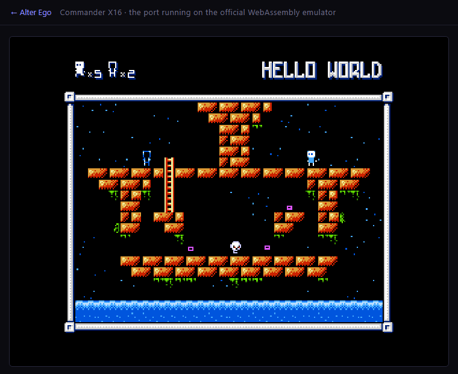

# x16/ — Commander X16 port workspace

This directory holds the **complete port** that carries this repository's Apple II VERA build
(`vera/`) back to the Commander X16: a bootable, playable build with title music and SFX
(`spike/dist/`), plus the evaluation report, probes and automation tooling.

> This is the English README.  The Traditional Chinese original is kept unchanged as
> [`readme-tw.md`](readme-tw.md) — same content, translated on 2026-11-06.

- Status in one line (2026-11-06): playable on x16emu — title menu, 26 levels (LV00–LV25),
  the exchange, the pause menu, the special keys, credits and the ending are all there.
  LV01 / LV03 / LV24 were played for real; the other levels go through the same loader
  routine.  There is also a browser build on GitHub Pages (see "Browser build"), and an
  SD-card zip in `build/` (see "SD-card package").  Still missing: real hardware and a long
  hands-on session (see "Status (honest version)").
- Evaluation report: [`docs/PORT-CX16-EVAL.md`](docs/PORT-CX16-EVAL.md) (read that first; the
  Traditional Chinese original is [`docs/PORT-CX16-EVAL-tw.md`](docs/PORT-CX16-EVAL-tw.md))
- Target: Commander X16 (65C02S / VERA), emulator `C:\dev\emu\x16emu` (r49)
- Toolchain: cc65 2.19 with `-t cx16`
- Porting another a2vera game (the next one is `freegemas`): the reusable guide distilled from this
  port is [`docs/A2VERA-to-CX16.md`](docs/A2VERA-to-CX16.md) — platform deltas, the asset layer, boot
  chain, input, cadence, the pitfalls table and a pre-flight checklist.  The Traditional Chinese
  version is [`docs/A2VERA-to-CX16-tw.md`](docs/A2VERA-to-CX16-tw.md).

## Layout

```
x16/
  docs/PORT-CX16-EVAL.md   evaluation + implementation record (platform comparison, reuse list,
                           the fixes one by one, the evidence)
  tools/shot.ps1           screenshot of the x16emu window (PNG, hides the console window)
  tools/play.ps1           several timed screenshots (key injection does not work with
                           x16emu, so this is only a fallback)
  tools/playtest.ps1       key-script driver (foreground window, one PNG per key;
                           `-KeySequence 'down,right:0.7,z:0.3'`)
  tools/pack-sd.ps1        builds `build/alter-ego-x16-sd.zip` from `spike/dist`
  probe/                   independent probes for VERA / the file API (io*.c, kload.s, shots)
  spike/                   the integrated cc65 `-t cx16` build (GAME + MUSIC overlay + LOADER.PRG)
    build.ps1              build script
    loader.s / loader.cfg  BASIC `SYS` boot loader
    game.cfg / music.cfg   linker configuration for the two binaries
    asset_cx16.c           asset layer (KERNAL LOAD; X16 flavour)
    io_cx16.c              level-file reader (VRAM staging + byte-by-byte read)
    kload_cx16.s           thin wrapper around `jsr $FFD5`
    input_cx16.s           X16 input layer: KERNAL GETIN + SNES `joystick_get` + VSYNC IRQ counter
    loadaddr.s / clrchn_cx16.s
    gate_cx16.s            `ae_midair_ok()` that no longer fits in the RAM area (the `GATE`
                           segment at $92DC)
    fallswap_sim.py        rebuilds the collision map from `dist/LVxx`, replays falling/exchange
                           geometry
    *_trace.py             other trace / wav analysis helpers (tritrace/bytrace/wavstat)
    dist/                  build output (GAME/MUSIC/LOADER.PRG/assets — the shipped build)
    work/                  compiler intermediates (main.s/main.o/game.map; not in git)
  build/alter-ego-x16-sd.zip  the SD-card package (see "SD-card package")
  bootmin/                 minimal HostFS root for debugging the load path (local scratch,
                           not in git)
```

## Build

```powershell
$env:CC65_BIN = 'C:\dev\cc65\bin'      # or put cc65\bin on PATH
powershell -NoProfile -ExecutionPolicy Bypass -File x16\spike\build.ps1
```

The output lands in `x16\spike\dist\`: `GAME` (29,698 B, including the 2-byte load header),
`MUSIC` (the overlay, 4,097 B), `LOADER.PRG` (1,026 B), and `TILES/CREDITS/CRPAL/.../LV00-LV25/*.PSG`
copied over from `vera\build\stage\`.

`build.ps1` only builds `spike/`; it never touches the Apple II artifacts under `vera/`.

## Running (x16emu)

```powershell
# load the loader and start it; HostFS root points at dist
C:\dev\emu\x16emu\x16emu.exe -prg x16\spike\dist\LOADER.PRG -run -fsroot x16\spike\dist

# faster (warp)
C:\dev\emu\x16emu\x16emu.exe -warp -prg x16\spike\dist\LOADER.PRG -run -fsroot x16\spike\dist

# screenshot (foreground capture; the emulator does not have to cooperate)
powershell -NoProfile -ExecutionPolicy Bypass -File x16\tools\shot.ps1 `
  -Prg x16\spike\dist\LOADER.PRG -FsRoot x16\spike\dist -Out x16\spike\shot.png -WaitSeconds 8
```

## SD-card package

[`x16/build/alter-ego-x16-sd.zip`](build/alter-ego-x16-sd.zip) (41,042 B, 37 entries, SHA256 `bb00f886…35b1f8fc`) is the
copy to hand to an X16 owner: unzip it **into the root** of the SD card and the game is
installed.  It ships as an asset of the repository's first release, tag
[`v0.0.2`](https://github.com/anomixer/alter-ego/releases/tag/v0.0.2), next to the two IIgs disks, so
an X16 owner can download it without a clone.  Rebuild it after `build.ps1` with

```powershell
powershell -NoProfile -ExecutionPolicy Bypass -File x16\tools\pack-sd.ps1
```

`pack-sd.ps1` packs `spike/dist/` from an explicit allow-list — `LOADER.PRG`, `GAME`, `MUSIC`,
`TILES`, `CRPAL`, `CREDITS`, `ENDPAL`, `ENDING`, `GOVER`, `GOPAL` and `LV00`–`LV25`, i.e. the
files the X16 build actually loads.  The Apple II staging leftovers in `dist/` stay out: the
`*.PSG` songs, `SFXBANK`, `LV00L`, `AE2VERA*#*`, `AEMUSIC*#*`, `BASIC.SYSTEM#*`, `PRODOS#*`,
`STARTUP#*` (the X16 build has no ProDOS, and its music comes from the `MUSIC` overlay).  The
archive has no wrapper directory — the loader reads the current directory — and its entries
are written in a fixed order with a fixed timestamp, so repacking the same `dist/` produces
the same bytes.  `README.TXT` rides along (plain ASCII, CRLF): what the files are, how to
install and start, the controls, notes and credits.

At the BASIC prompt on the machine, with the card as drive 8:

```basic
LOAD "LOADER.PRG",8,1
RUN
```

Renaming `LOADER.PRG` to `AUTOBOOT.X16` makes the game start by itself at power-on (the ROM
runs a BASIC program on the card with that name).  Autoboot cannot be exercised in x16emu's
HostFS — the ROM's own `LOAD "AUTOBOOT.X16"` is an upper-case name, and HostFS rejects those
— so the package is verified the HostFS-safe way: unzip into a scratch directory and boot the
extracted copy.

```powershell
x16emu -prg <scratch>\LOADER.PRG -run -fsroot <scratch>
```

That booted the title screen and, on `Enter`, Level 1 `HELLO WORLD`, then moved on a held
`Right` — so every packed file is exercised: loader, `GAME`, `MUSIC`, `TILES`, the level file
and the palette assets.

Not verified: a real SD card with cmdr-dos.  The FAT path matches names without regard to
case, which is why the archive keeps the upper-case names a typed `LOAD "LOADER.PRG",8,1`
expects, while the game itself asks for lower-case names through its asset layer.

## Browser build (GitHub Pages)

The same `dist/` also runs directly in a browser:
<https://anomixer.github.io/alter-ego/x16/index.html>



Everything lives in `web/x16/`:

1. `web/x16/assemble.mjs` downloads the official X16Community WebAssembly release
   `x16emu_wasm-r49.zip` when the site is built (`x16emu.js`, `x16emu.wasm`, `x16emu.data`,
   pinned with SHA-256 `9711036c…628f`).  The archive is cached in `web/x16/build-cache/`
   (gitignored) and the release itself is never committed; `x16emu.data` contains the X16 ROM,
   so `web/x16/` also carries `emulator-license.txt` / `rom-license.md` and `NOTICE.md`.
2. The files the game needs from `x16/spike/dist/` are copied under **lower-case names**
   (`game`, `music`, `loader.prg`, `tiles`, `crpal`, `credits`, `ending` / `endpal` / `gover` /
   `gopal`, `sfxbank`, `lv00`…`lv25`, `lv00l`) plus a `manifest.json` into the site's
   `x16/game/`.  They must be lower case: the X16 HostFS compares byte for byte (see the asset
   layer above), and the emulator's file system in the browser is case-sensitive.
3. `web/x16/app.js` uses the official wasm build's `Module` interface: it `FS.writeFile`s every
   file into the emulator's virtual drive `/`, then starts `-prg loader.prg -run` — the same
   `LOADER.PRG` and the same KERNAL LOAD asset path as on the machine / in x16emu.
4. `web/build-site.mjs` (run by the GitHub Pages workflow) packs the two together into
   `web/_site/x16/`, and the landing page `web/index.html` gained a "Commander X16" card.

How to verify it (no manual clicking required):

- Locally: `node web/build-site.mjs` produces `web/_site/`; serve it with any static server and
  open `web/_site/x16/index.html`.
- Automated: headless Edge + the DevTools protocol (`tmp/x16web/capture.mjs`, not in git)
  opens the page, sends `Enter` and takes screenshots; the title screen and Level 1
  (`HELLO WORLD`, HUD `x5`/`x2`) both appeared, which means the wasm build's HostFS, keyboard
  events and VERA output all work.
- Music needs a user gesture before browsers allow sound; the page's "Sound" button only says
  `Sound on` once `Module.SDL2.audioContext` is really running.

## Debugging aids

- **`$9FB9` beacon**: write `*(volatile unsigned char *)0x9FB9 = 'X';` anywhere and the emulator
  console prints `User debug 1: $58` — a progress lamp that needs no `-log`.
- **VRAM mirror**: `-dump V` plus "set `$9FB5=1` then jump to `$FFFF`" produces `dump.bin`
  (128 KB of VRAM plus the composer/palette/layer registers), which lets you compare offline
  whether the assets really did land.
- **Screenshots**: `x16/tools/shot.ps1` (`-Prg`/`-FsRoot`/`-Bas`, `-WaitSeconds`).

## Playable today (2026-11-05)

Run it (`-fsroot` points at `dist`; HostFS reads the files directly):

```powershell
C:\dev\emu\x16emu\x16emu.exe -prg x16\spike\dist\LOADER.PRG -run -fsroot x16\spike\dist
```

Keys (X16 keyboard; the held state of the arrow keys and A/B comes from the KERNAL keyboard
joystick, START/SELECT are single-frame pulses — see the next two sections):

| Action | Key |
| --- | --- |
| START (enter level / pause menu / resume) | `Enter` or `Space` |
| Move / climb | arrow keys (holding walks continuously; no waiting for key auto-repeat) |
| A (exchange / confirm) | `X` (or `J`) |
| B (exchange) | `Z` (or `K`) |
| SELECT (cow level) | `1` or `Left Shift` |
| Title menu up/down | arrow up/down; left/right change the option / level number |
| SFX/BGM test screen | `T` (or hold `X`+`Z` and press `Enter`/`Space`; `T`/`ESC` leaves) |
| Music mute / SFX mute | `M` / `N` (the title screen shows MUSIC OFF / SOUND OFF immediately) |
| Level-skip cheat | `Z`, left, `X`, `Z`, left, `X`, then `1` inside a level |

The implementation and measurement of the special keys is in "Special keys" below (including
the X16-specific adjustment to the cheat).

Measured (x16emu r49, `x16/tools/playtest.ps1` sending real scan codes):
`Enter` enters Level 1 → right arrow moves (`x16/spike/shot-input-right.png`) → `Z` exchanges
(HUD `x2`→`x1`, `x16/spike/shot-input-exchange.png`) → `Enter` pauses (RESUME/RESTART/EXIT GAME)
→ `Enter` resumes; after selecting START LEVEL 03 in the title menu, `Enter` loads "BROKEN
BRIDGE".  Screenshots: `x16/spike/play-*.png`, `x16/spike/menu-*.png`.

### Fixed: the first press walked one step, then waited half a second

While an arrow key is held, the X16 KERNAL only puts the pressed character into the keyboard
queue; the next character waits for **the OS/SMC key auto-repeat** (on x16emu that is driven by
Windows and defaults to about 0.5 s), so a version that only reads `GETIN` walks one tile,
stalls, then continues.

The real answer is **`joystick_get($FF56)` device 0: the KERNAL keyboard joystick**.  It updates
with press/release (it does not just latch the last key), so "held" is immediate.  `x16/spike/input_cx16.s`
now merges device 0's bits straight into the pad:

- **Directions (level-sensitive)**: holding walks continuously, releasing stops the same frame.
  The arrow keys' "hold timer" is only used when the keyboard joystick does **not** exist (that
  is when key events have to be compensated for).  This is the "one tile too far" fix: the timer
  used to keep running for 8 more frames after release, just enough for one extra step.
  Measured (beacon reading `player_x`): hold right for 0.25 s and x goes 184→200 (16 px, exactly
  a tile boundary); before the fix it overshot to 208.
- **A/B (level-sensitive)**: real pads and the NES treat these as "held", and the game itself
  uses `exchange_input_lock` to stop repeated exchanges, so level-sensitive does not repeat-fire;
  it also fixes "hard to exchange while falling" — the exchange check during a fall only runs on
  each 8 px landing row (`player_fall_steps==0`), so a single-frame pulse had to hit that exact
  frame.  Measured: hold right+Z for 3 s (walking off a platform edge), HUD `x2`→`x1`, the two
  Egos swap immediately (`x16/spike/shot-input-exchange-fall.png`), and holding Z for 3 s
  exchanges exactly once.
- **START/SELECT (rising edge, single-frame pulse)**: if `Enter` were level-sensitive the pause
  menu would reopen every frame, so these two still use edge detection.
- If the keyboard joystick is absent (`Y != 0`), the old key events plus the `KEY_LOCK` filter
  are used instead.

Key events are still kept for keys the keyboard joystick does not map: `Space` (START) and `1`
(SELECT); `X`/`Z`/`Enter` are mapped there, so they are no longer handled twice.  Because the
keyboard joystick only maps the directions, `WASD` was dropped on the X16 (to avoid the
inconsistent "hold for half a second" feel).

### Boot credits screen

A cold boot shows the credits for 150 frames (2.5 s, `Enter` skips them) before the title.  The
X16 platform line is **`COMMANDER X16 CONVERSION BY`** (blue) and `ANOMIXER 2026` (orange);
screenshot `x16/spike/shot-credits-x16.png`.

That line is burned into the `CREDITS` nametable asset (generated by
`vera/tools/a2vera_art.py`).  To keep `vera/build/*` byte-identical for the Apple II, the X16
build regenerates the credits only into `x16/spike/work/art/` and then overwrites
`dist/CREDITS` and `dist/CRPAL`:

```powershell
$env:AE2VERA_CREDITS_PLATFORM = 'COMMANDER X16'   # the default is 'APPLE II VERA'
```

### Special keys: T (SFX/BGM test), M/N (mutes), level skip, cow level

The Apple II build's `keyboard_pad()` has a few keys that are not pad buttons: `T` maps straight
to the NES START+A+B (opens the SFX/BGM test screen), `M`/`N` toggle the music/SFX mutes, `ESC`
leaves the test screen, plus the NES cheat (B, left, A, B, left, A then SELECT clears the level)
and SELECT for the cow level.  The X16 build wires all of them up:

| Key | Effect |
| --- | --- |
| `T` (or hold `X`+`Z` and press `Enter`/`Space`) | open the SFX/BGM test screen (`SFX 00 BGM 0`) |
| inside the test screen | arrows pick SFX/BGM, `Z` plays the sound in SFX mode, `Z` plays the song in BGM mode, `X` stops |
| `T` / `ESC` | leave the test screen, back to the title |
| `M` / `N` | toggle MUSIC ON/OFF, SOUND ON/OFF (the title screen text changes immediately) |
| `1` or `Left Shift` (SELECT) | title screen: enter the cow level (`COW LEVEL`, level 0) |
| `Z`, left, `X`, `Z`, left, `X` then SELECT | level-skip cheat (shows `LEVEL CLEAR`) |

Implementation: `input_cx16.s`'s `mapkey` sets a single-frame flag on `T`/`M`/`N`/`ESC`
(`_ae_key_t`/`_ae_key_m`/`_ae_key_n`), and `main.c`'s `VERA_X16` branch applies it, so there is
no need to read the `$C000` keyboard latch that does not exist on the X16 (the Apple II path is
untouched).

The cheat needed one X16-specific adjustment: A/B are level-sensitive on the X16, so comparing
`pad == code[i]` every frame like the Apple II does would reset the index on the second frame of
the same hold (i.e. the input had to be frame-exact).  The X16 build therefore counts **pad
changes** instead (`#ifdef VERA_X16`), so tapping at a normal speed works; measured: `z,left,x,z,left,x`
then `1` shows `LEVEL CLEAR` (`x16/spike/shot-level-skip.png`).

Screenshot evidence: `x16/spike/shot-soundtest.png` (test screen, BGM mode),
`x16/spike/shot-cow-level.png` (`COW LEVEL`), `x16/spike/shot-mute-keys.png` (`MUSIC OFF` +
`SOUND OFF`), `x16/spike/shot-level-skip.png` (`LEVEL CLEAR`).

### Exchanging while falling: the X16 checks every frame (last fix 2026-11-05)

`x`/`z` (A/B) have no keyboard latch, but "you press and it takes 3–4 body heights to exchange"
really was a bug.

The cause is the NES original's flow: it only checks the exchange when `player_dir==DIR_NONE`
(standing, or the gap while falling); each falling row is `player_move_cnt=8`, i.e. **only one
frame out of every 8 px**.  Copied faithfully to the X16, that means A/B has to land inside a
one-frame window, which players feel as "I mash it and it often ignores me".  On the Apple II the
`$C010` any-key-down flag is level-sensitive, so a hold happens to cover that frame, which is why
it mostly just felt "occasionally sluggish" there.

Fix (`main.c`, `#ifdef VERA_X16`):

```c
if (player_fall_steps && !exchange_active && items_left &&
    (pad&(PAD_A|PAD_B)) && !exchange_input_lock) {
    begin_player_exchange();
    collected=1;
}
```

Every frame of a fall now accepts A/B, and the first frame of the press (or hold) starts the
exchange without waiting for a landing row.  The Apple II build does not compile this block, and
its output bytes are unchanged.

Evidence (built with `AE_EXTRA_DEFINES='AE_DEBUG_FALL'`, which writes
`(player_y&$F8)|(pad&$07)` to `$9FB9` every frame and is decoded by `x16/spike/bytrace.py`):

- `enter,right:0.7,z:0.3`: the very first sample with `z` held is on a falling row (`y=144`), and
  `y` then freezes (the exchange animation runs); the HUD exchange count goes `x2` → `x1`
  (`x16/spike/ma-3-z.png`, `x16/spike/fx-3-z.png` are from the shipped build).
- `enter,right:0.7,x:0.3`: `x` (the A button, `pad=0x01`) triggers on the first frame as well
  (`x16/spike/mb-3-x.png`).
- Before the fix the same fall needed 3–4 rows (24–32 px) to exchange, exactly matching the "only
  1 in 8 frames is checked" odds.

### No falling through the floor after an exchange: snap the landing to the tile first (2026-11-06)

Once every frame could exchange mid-air, a report came in: "sometimes it falls through the
floor".  The cause is not the swap itself but that **the exchange animation freezes the fall
between tile rows**: on the frame A/B is pressed, `player_y` sits at `r` of an 8 px row
(`r=1..7`), `y` does not move during the animation, and when it ends `player_fall_steps` still
holds "the steps left in this 8 px step".  `update_player_fall()` then sees a non-zero step count
and **keeps falling without re-testing the floor in the mirrored column**; if the next row happens
to be a solid tile the hero "sinks into" it, and gravity only looks at the tile under the feet
(`y+8`, i.e. the row below the solid tile = empty), decides "no floor" → keeps falling = straight
through the platform.

Fix (`main.c`, `#ifdef VERA_X16`): record a flag when an exchange starts during a fall, and when
the animation finishes snap `y` back to the row it was on and clear the unused steps, so gravity
re-tests the mirrored column.

```c
/* the mid-air trigger in game_loop() (ae_midair_ok is below) */
if (ae_midair_ok()) begin_player_exchange();
if (exchange_active) exchange_midair=1;

/* advance_player_exchange(), on reaching the landing spot */
#ifdef VERA_X16
if (exchange_midair) {
    exchange_midair=0;
    player_y=(uint8_t)(player_y&0xF8);  /* back to the row we were falling in */
    player_fall_steps=0;                /* let gravity re-test the mirrored column */
}
#endif
```

Exchanging while standing is unaffected (`player_fall_steps` is already 0 and `exchange_midair`
is not set), the Apple II build does not compile this block, and its output bytes are unchanged.
After an exchange the hero always lands on a tile row: if the mirrored column has floor below, it
stops there; if not, it keeps falling.

**The other half of the story: the vertically mirrored levels (`sync_type=1`: LV05/08/15/19/24).**
In those levels the second Ego is mirrored top-to-bottom (`y=240-player_y`), so a mid-air exchange
means "teleport through the platform to the mirrored height" — that is exactly the LV24 ALMOST
THERE screenshot in the report (HUD `x5`/`x5`, hero hanging under the main platform): pressing `z`
while falling above the main platform mirrors onto the spot right below it, and the exchange
animation delivers the hero under the floor, "through the ground".  The geometry is more concrete:
before the fix these five levels accepted 14,616 mid-air exchanges, and **13,538 of them (93%)**
had no floor under the landing spot.

So in vertically mirrored levels a mid-air exchange additionally requires "the mirrored spot has
floor under it" (see `ae_midair_ok()` in `x16/spike/gate_cx16.s`): if the mirrored height happens
to be a legal landing spot it swaps immediately, otherwise it keeps falling and swaps on the first
frame with a landing spot.  In these five levels 1,694 falling frames are accepted (the other 20
levels still "swap on press", unaffected), and the number of floor-through cases is 0.

Evidence (`x16/spike/fallswap_sim.py`, which reads `dist/LV00..LV25` directly, rebuilds the
collision map and replays the geometry of `check_map()` / `update_player_fall()` /
`advance_player_exchange()`):

- Before the fix: of 65,667 "pressed A while falling" situations, **756** put the hero's own tile
  inside a solid tile (e.g. LV00, falling from `x=104,y0=96` and pressing A → mirrored `x=144`,
  the landing spot `(144,104)` is inside a tile, and it goes straight through).
- After the fix: **0** (the vertically mirrored levels are included: when the landing spot has no
  floor, `ae_midair_ok()` refuses the exchange).
- x16emu measurement (shipped build): `enter,right:0.7,z:0.3` (LV01 HELLO WORLD) exchanges while
  falling, the count goes `x2`→`x1`, and the hero stands on the ground (`x16/spike/g1-3-z.png`);
  in LV24 ALMOST THERE, pressing `z` while falling at the main-platform height leaves the hero
  **standing on the main platform** with the count `x6`→`x5` (`x16/spike/g24-27-z.png`) instead of
  being sent under it.

### Objective audio check (`-Wav` + `wavstat.py`)

Sound can be captured as well as pixels: `playtest.ps1 -Wav <file.wav>` makes x16emu record, and
`x16/spike/wavstat.py` repairs the wav first (the test force-kills the emulator, which never gets
to write the RIFF/data lengths back) and then prints RMS/peak per segment.

Measured (title music + the `T` test screen):

| Segment | Result |
| --- | --- |
| Title music | rms ≈ 0.08–0.11 per second, peak ≈ 0.4 |
| Entering the `T` screen | title music stops → rms drops to 0.005 |
| Pressing `Z` in SFX mode | a short burst (250 ms window: rms 0.09, peak 0.105) |
| Pressing `Z` in BGM mode | back to a sustained rms ≈ 0.10 (the song restarts from the top) |

So both the SFX and the BGM of the test screen really do produce output, not just pixels.

### Music tempo trim (`AE_X16_TEMPO_TRIM`)

The X16 loop is locked to VSYNC at 60 Hz and the music gets exactly one FamiTone source tick per
frame; to go slightly faster, there is a trim in 1/256-tick units:

```powershell
$env:AE_X16_TEMPO_TRIM='8'   # 0 = the NES's original 60 Hz; 8 ≈ +3.1%; 16 ≈ +6.2%
powershell -NoProfile -ExecutionPolicy Bypass -File x16\spike\build.ps1
```

The default is `8` (+3.1%).  It is implemented in `music_tick_impl()` in
`vera/src/a2vera/ftm_player.c`: an 8-bit accumulator that fires one extra tick whenever it wraps
256, so there is no long-term drift, and the Apple II build is unaffected.

### The critical bug that got fixed: the VSYNC interrupt is the KERNAL's pulse

The real reason for the earlier "none of the buttons work" was not the way keys were sent, but
that **we had switched the X16 KERNAL's IRQ off**.  The X16 KERNAL's 60 Hz IRQ (jiffy clock +
keyboard scan) is sourced from the **VERA VSYNC interrupt**, and early in this work, in order to
wait for VSYNC with `while(!(VERA_ISR&1))`, `vera_sync_init()` cleared `VERA_IEN` → the KERNAL IRQ
never ran → `GETIN` always returned 0 and the jiffy clock stopped.

The fix (two files):

- `x16/spike/input_cx16.s`: `_ae_irq_install` hooks `$0314/$0315`; the handler only does
  `inc _ae_irq_frames` and tail-calls the original KERNAL handler (it does not touch the ISR;
  the KERNAL clears it).
- `vera/src/a2vera/main.c`: the `#ifdef VERA_X16` `vera_sync_init()` becomes
  `VERA_ISR=0x0F; VERA_IEN=0x01; ae_irq_install();`, and `wait_frame()` waits for
  `ae_irq_frames` to change.  The Apple II path is untouched (it also compiles cleanly with
  `-t apple2`, zero errors).
- In addition, `asset_cx16.c` now calls `CLRCHN` (`$FFCC`) after every KERNAL LOAD, otherwise
  `GETIN`'s input channel still points at the file.

## Status (honest version, 2026-11-06)

- ✅ The Apple II VERA build's C/asm **compiles, assembles and links** with `-t cx16` and produces
  a runnable `GAME` / `MUSIC` / `LOADER.PRG`.
- ✅ x16emu boots it and runs the loader; the VERA register layer (base `$9F20`) is 1:1 with the
  Apple II version.
- ✅ **Asset loading works**: x16emu r49's HostFS compares file names against the **raw bytes** of
  `SETNAM`, so an upper-case name returns `A=4` (FILE NOT FOUND) and only a lower-case name
  actually loads.  With every name lower-cased, `music`/`game`/`tiles`/`crpal`/`credits` all land
  (the VRAM read-back matches the host file byte for byte, see `x16/spike/t5.s`, `t8.s`).  Details
  in evaluation report §7.5.
- ✅ **The title screen renders on the X16**: `ALTER EGO`, the menu (START GAME / START LEVEL /
  MUSIC ON / SOUND ON), the starfield and the hardware sprites are all correct; screenshot
  `x16/spike/shot-title-final.png`.
- ✅ **Level 1 loads, renders and is playable**: the `HELLO WORLD` title, the HUD (5 lives, 2
  exchanges), the brick platforms, ladders, enemies, water and starfield are all correct;
  screenshot `x16/spike/shot-level1-plays.png`; the controls were verified as above.
- ✅ **The cadence is 60 Hz (the NES's native speed)**: the X16 game loop is locked to VSYNC at 60
  per second, and a single frame is never skipped (comparing `ae_irq_frames` inside the loop never
  shows a delta > 1).  The Apple II FTM build only runs about 40 times a second, which is why it
  needs the "1.5 NES steps per loop" and "1.5 music ticks per loop" compensation; carrying that
  compensation over to a 60 Hz X16 makes everything 1.5× too fast.  `#ifdef VERA_X16` now
  overrides it: `logic_delta=1`, and exactly one music source tick per frame.  Measured: the hero
  walks ~58–62 px per second (the NES is 60 px/s, and holding a direction starts walking on the
  first frame); before the fix it was ≈101 px/s.
- ✅ **The mid-air exchange is fixed in three parts**: swap on press (see "Exchanging while
  falling"), snap the landing to a tile and clear the fall steps after the exchange, and in
  vertically mirrored levels only swap when the mirrored spot has floor under it (see "No falling
  through the floor").  A geometric simulation of 65,667 fall/exchange situations: 756 cases sank
  into a tile before the fixes, 0 after.
- ✅ **The shipped directory has 26 levels** (`LV00`–`LV25`, including the cow level's `LV00L`
  variant): LV01 (HELLO WORLD), LV03 (menu-selected BROKEN BRIDGE) and LV24 (vertically mirrored
  ALMOST THERE) were played for real; the rest go through the same `load_level_file()`, without
  per-level play testing.
- ✅ **Browser build**: `web/x16/` (GitHub Pages) runs the same `dist/` on the official
  X16Community r49 WebAssembly emulator; the assets are written into the emulator's virtual drive
  under lower-case names and started with `-prg loader.prg -run`.  The title screen and Level 1
  (`HELLO WORLD`, HUD `x5`/`x2`) were verified with headless Edge.
- 🎵 The music tempo can be trimmed further: the default is `AE_X16_TEMPO_TRIM=8` (+3.1%), see
  "Music tempo trim" above.
- ⚠️ Not yet verified by a human over a long session: the full death / level-change / ending flow,
  how the music and SFX actually sound, real hardware (not the emulator), and SD/DOS boot
  packaging.

## Two porting bugs fixed while clearing Level 1

1. **`read()` clobbered the caller's VERA address** (`io_cx16.c`).  Level files are read
   byte-by-byte from VRAM staging (`$A000`), while `load_level_file()` writes the map to
   `VERA_DATA0` in the same loop.  `read()` reset the VERA address on every staging read, so the
   map was written to `$A000+`, the level data overwrote itself, `load_level_file()` returned 0 and
   the screen stayed black.  Fix: `read()` saves and restores `VERA.address` and `address_hi`
   (2 bytes each) around itself, so the caller's pointer survives.
2. **`keyboard_pad()` read the Apple II `$C000`/`$C010` keyboard latch** (`main.c`).  The X16 has
   no such hardware; `$C000` falls in ROM and returns a fixed byte, which becomes "a direction is
   permanently held".  A `#ifdef VERA_X16` branch now returns `joystick_pad()` directly
   (`input_cx16.s` already merges the KERNAL keyboard joystick with the SNES pad).  The Apple II
   build behaves as before.

## Automated testing (synthetic keys, screenshots)

- **Synthetic keys need real scan codes**: `keybd_event(vk, MapVirtualKey(vk,0), flags)`.  Sending
  only `vk` with a scan code of 0, or using only `SendKeys`/`SendMessage`, never reaches the
  guest.  Arrow keys additionally need `KEYEVENTF_EXTENDEDKEY` (down flags=1, up flags|2).
- `x16/tools/playtest.ps1`: send `-KeySequence 'enter,right:2,z,enter'` (comma-separated
  `name[:seconds]`; `name` can also be joined with `+` to hold keys together, e.g. `right+z:3` is
  "hold right and Z for three seconds", used to test the mid-air exchange); one PNG per step;
  `-Stamp` sets the file-name prefix.
- Window handling: take the PID with `Start-Process -PassThru`, get the SDL window from
  `$proc.MainWindowHandle`, then `SetWindowPos(HWND_TOPMOST, 40,40)` + `AttachThreadInput` +
  `SetForegroundWindow` before sending keys / taking screenshots.  **If the user has another
  x16emu in the foreground, synthetic keys and screenshots go to that window**; so `playtest.ps1`
  checks `GetForegroundWindow() -eq its own hwnd` after grabbing the foreground and fails loudly
  instead of photographing someone else's screen (this happened once on 2026-11-05: every
  screenshot was the user's Level 2 "PROMENADE").
- `main.c` also has an `#ifdef AE_X16_AUTOSTART` test hook: only when built with
  `$env:AE_X16_AUTOSTART='1'` does it skip the title and jump into Level 1.  Normal builds do not
  contain it.
- Position measurements use `$env:AE_EXTRA_DEFINES='AE_DEBUG_XY'`: every 10 frames the loop writes
  `player_x`/`player_y`/`pad` to `$9FB9` (x16emu's `User debug 1`, printed on stdout), and
  `playtest.ps1` collects it in `%TEMP%\playtest-out.txt`.  "Hold right for 0.25 s walks 16 px" was
  measured this way.  `AE_EXTRA_DEFINES` takes any number of `-D` options (space separated).  The
  parser is `python x16\spike\tritrace.py` (three bytes per group: x/y/pad).  There is also
  `AE_DEBUG_TITLE`: in the **title loop** it prints `pad`/`level_skip` every 6 frames (that is how
  the `z,left,x,z,left,x` cheat was confirmed to produce the pad sequence and to really set
  `level_skip` to 1); `AE_DEBUG_PAD` prints only `pad` in the title loop **every frame** (to
  measure whether A/B are level-sensitive: holding `Z` for a second shows ~61 consecutive `02`s
  rather than a one-frame pulse).
- Fall measurements use `AE_DEBUG_FALL`: each frame writes a single byte
  `(player_y&$F8)|(pad&$07)`, parsed by `python x16\spike\bytrace.py`.  More than three beacons per
  frame occasionally get dropped/misaligned in x16emu, so when frame-by-frame alignment matters the
  data is squeezed into one byte (with `pad` in the low 3 bits).
- "Does an exchange during a fall go through the floor?" needs no emulator:
  `python x16\spike\fallswap_sim.py` parses the collision map of `dist/LVxx` directly, replays the
  falling geometry (`--fix` compares the fixed build) and counts "hero tile became solid" cases;
  `--level 24` looks at a single level.
- Audio: `-Wav <file.wav>` makes x16emu record, and
  `python x16\spike\wavstat.py <file.wav> [window seconds]` prints RMS/peak per segment.  The test
  scripts force-kill at the end, so x16emu never writes the RIFF/data lengths back; `wavstat.py`
  patches them in memory before parsing, so that wav can be fed straight in.
- These test scripts always kill the emulator in a `try/finally`: if one is left running, its
  inherited redirected stdout keeps a pipe-holding caller from ever seeing EOF, which looks like
  the script hanging (this actually happened once on 2026-11-05).

## Memory headroom (important)

`x16/spike/game.cfg`'s BSS area now has **6 bytes left** (`BSS` ends at `$6749`, `FTMDATA` starts
at `$6750`; `FTMSFX $819D` and `FTMTABLE $8500` are fixed addresses shared with the `MUSIC`
overlay — do not move them).  Earlier, the extra code for "T opens the test screen + M/N mutes"
overflowed BSS (`ld65: Segment 'BSS' overflows memory area 'BSS' by 57 bytes`); the answer was to
wrap the Apple II dead code the X16 does not use (`KEYBOARD`/`KBDSTRB`/`keyboard_model` blocks) in
`#ifndef VERA_X16`, which recovered about 96 bytes of CODE and 3 bytes of BSS.  On 2026-11-05,
§7.10's "check the exchange every frame while falling" cut the remaining Apple II dead code
(`keyboard_level_reset`, credits' `KBDSTRB`, the pause menu's `keyboard_model` test, the
`keyboard_last_pad`/`keyboard_last_held` declarations), which exactly paid for the new code.
2026-11-06's "snap the landing to a tile" added 1 byte (`exchange_midair`) and about 29 bytes of
CODE; the C version of "the mirrored spot needs floor" (about 38 bytes) then blew BSS up, so it
was rewritten as hand-written assembly in `x16/spike/gate_cx16.s` and placed in the main-RAM hole
`$92DC` via a new `GATE` segment in `game.cfg` (`FTMTABLE` ends at `$92DB`, `FTM_HIGH_BSS` starts
at `$93A0`, 196 bytes).  Now `CODE` ends at `$5A67` and `BSS` at `$6749`, **6 bytes left**; `GATE`
occupies `$92DC-$933A` (95 bytes).  Beacons like `AE_DEBUG_XY`/`AE_DEBUG_FALL` no longer fit — to
debug you have to cut dead code first or find another hole (`$83F2-$83FF` 14 bytes and
`$933B-$939F` about 100 bytes are still free).
Before adding features, check that `ld65` does not overflow; otherwise cut dead code or adjust the
config.

## Relationship to `vera/`

- `vera/src/a2vera/main.c` only gained `#ifdef VERA_X16` branches (asset loading calls
  `ae_load_raw_asset`; `vera_sync_init()`/`wait_frame()` use the VSYNC IRQ counter, see above).
  Without `VERA_X16` defined the behaviour is exactly the original Apple II build; "check the
  exchange every frame while falling", "snap the landing to a tile" and "the mirrored spot needs
  floor" live only in the X16 branches too.
- So that `gate_cx16.s` can read `player_x`/`player_y`/`sync_type`/`collision_map`, those four
  variables went from `static` to external linkage; that only affects the symbol table and leaves
  the Apple II code unchanged (on 2026-11-06 both spellings were compiled with cc65 `-t apple2`
  and compared: 6,166 instructions, 0 differing lines, the listing only gained four `.export`s).
- The Apple II version never had the "fall through the floor" problem (the exchange only happens
  on a landing row, so `player_fall_steps` is always 0), so `vera/`'s behaviour **stays as it was
  and the release images do not move**.
- Nothing in `x16/` affects the Apple II release images in `vera/build/`.
