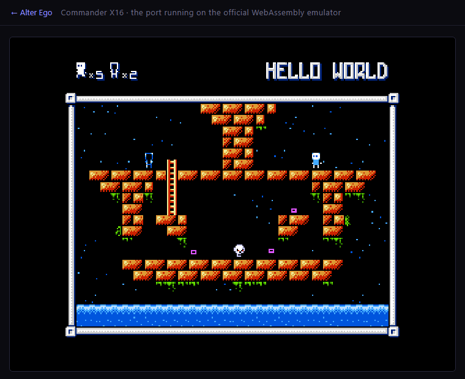

# x16/ — Commander X16 移植工作區

> 英文版：[`README.md`](README.md)。本檔是 2026-11-06 翻譯前的繁體中文原文，內容與
> 英文版相同；改動請兩邊一起改（README.md 是英文主檔，readme-tw.md 是中文存檔）。

這裡放的是「把本 repo 的 Apple II VERA 版（`vera/`）移植回 Commander X16」的
**完整移植**：可開機、可操作、有標題音樂與 SFX 的出貨版（`spike/dist/`），加上
評估報告、probe 與自動化工具。

- 一句話現況（2026-11-06）：x16emu 上可玩——標題選單、26 個關卡（LV00–LV25）、
  交換、暫停選單、特殊按鍵、credits、結局都在；實際遊玩驗證過 LV01／LV03／LV24，
  其餘關卡共用同一支載入程式；瀏覽器版已上 GitHub Pages（見「瀏覽器版」）。
  尚差實機、SD/DOS 打包與長時間真人試玩（詳見
  「目前的狀態（誠實版）」）。
- 評估報告：[`docs/PORT-CX16-EVAL.md`](docs/PORT-CX16-EVAL.md)（建議先讀；英文主檔，中文原文在
  [`docs/PORT-CX16-EVAL-tw.md`](docs/PORT-CX16-EVAL-tw.md)）
- 目標平台：Commander X16（65C02S / VERA），模擬器 `C:\dev\emu\x16emu`（r49）
- 工具鏈：cc65 2.19 的 `-t cx16`

## 目錄

```
x16/
  docs/PORT-CX16-EVAL.md   評估＋實作記錄（平台對照、重用清單、逐項修正、證據）
  tools/shot.ps1           x16emu 視窗截圖工具（PNG，含 console 窗遮蔽處理）
  tools/play.ps1           多張定時截圖（送鍵在 x16emu 上無效，僅作輔助）
  tools/playtest.ps1       送鍵腳本（前景視窗逐 key 截圖；`-KeySequence 'down,right:0.7,z:0.3'`）
  probe/                   VERA / 檔案 API 的獨立 probe（io*.c、kload.s、截圖）
  spike/                   cc65 `-t cx16` 的整合建置（GAME + MUSIC overlay + LOADER.PRG）
    build.ps1              建置腳本
    loader.s / loader.cfg  BASIC `SYS` 開機載入器
    game.cfg / music.cfg   兩個 binary 的 linker 設定
    asset_cx16.c           資產載入層（KERNAL LOAD；X16 版）
    io_cx16.c              關卡檔讀取層（VRAM staging + 逐 byte 讀）
    kload_cx16.s           `jsr $FFD5` 的薄包裝
    input_cx16.s           X16 輸入層：KERNAL GETIN + SNES `joystick_get` + VSYNC IRQ 計數
    loadaddr.s / clrchn_cx16.s
    gate_cx16.s            RAM 區塞不下的 `ae_midair_ok()`（放 `GATE` 段 $92DC）
    fallswap_sim.py        從 `dist/LVxx` 重建碰撞圖、重播掉落／交換幾何
    *_trace.py             其他 trace／wav 分析工具（tritrace/bytrace/wavstat）
    dist/                  建置產物（GAME/MUSIC/LOADER.PRG/資產，出貨版）
    work/                  編譯中間檔（main.s/main.o/game.map；不進版控）
  bootmin/                 最小 HostFS 根目錄（除錯載入行為用；本機暫存，不進版控）
```

## 建置

```powershell
$env:CC65_BIN = 'C:\dev\cc65\bin'      # 或把 cc65\bin 加進 PATH
powershell -NoProfile -ExecutionPolicy Bypass -File x16\spike\build.ps1
```

產物在 `x16\spike\dist\`：`GAME`（29,698 B，含 2-byte 載入標頭）、`MUSIC`（overlay，
4,097 B）、`LOADER.PRG`（1,026 B）、以及從 `vera\build\stage\` 複製過來的
`TILES/CREDITS/CRPAL/.../LV00-LV25/*.PSG`。

`build.ps1` 只建置 `spike/`，不會動到 `vera/` 的 Apple II 產物。

## 執行（x16emu）

```powershell
# 直接載入 loader 並自動執行；HostFS 根目錄指向 dist
C:\dev\emu\x16emu\x16emu.exe -prg x16\spike\dist\LOADER.PRG -run -fsroot x16\spike\dist

# 加速（warp）
C:\dev\emu\x16emu\x16emu.exe -warp -prg x16\spike\dist\LOADER.PRG -run -fsroot x16\spike\dist

# 截圖（前景截圖，不需模擬器配合）
powershell -NoProfile -ExecutionPolicy Bypass -File x16\tools\shot.ps1 `
  -Prg x16\spike\dist\LOADER.PRG -FsRoot x16\spike\dist -Out x16\spike\shot.png -WaitSeconds 8
```

## 瀏覽器版（GitHub Pages）

同一個 `dist/` 也可以直接在瀏覽器裡跑：
<https://anomixer.github.io/alter-ego/x16/index.html>



做法都在 `web/x16/`：

1. `web/x16/assemble.mjs` 在建站時抓官方 X16Community 的 WebAssembly 發行版
   `x16emu_wasm-r49.zip`（`x16emu.js`、`x16emu.wasm`、`x16emu.data`，SHA-256
   `9711036c…628f` 固定）。下載過的壓縮檔留在 `web/x16/build-cache/`（gitignored），
   發行版本身不進版控；`x16emu.data` 內含 X16 ROM，所以 `web/x16/` 也放了
   `emulator-license.txt`／`rom-license.md` 與 `NOTICE.md`。
2. 把 `x16/spike/dist/` 需要的檔案複製成**小寫檔名**（`game`、`music`、`loader.prg`、
   `tiles`、`crpal`、`credits`、`ending`／`endpal`／`gover`／`gopal`、`sfxbank`、
   `lv00`…`lv25`、`lv00l`），加上 `manifest.json`，放進網站上的 `x16/game/`。
   一定要小寫：X16 的 HostFS 是位元組精確比對（見上面 asset 層的說明），而瀏覽器裡
   模擬器的虛擬檔案系統區分大小寫。
3. `web/x16/app.js` 走官方 wasm 版的 `Module` 介面：先把每個檔案 `FS.writeFile` 寫進
   模擬器的虛擬磁碟 `/`，再以 `-prg loader.prg -run` 啟動——和實機／x16emu 是同一支
   `LOADER.PRG`、同一條 KERNAL LOAD 資產路徑。
4. `web/build-site.mjs`（GitHub Pages workflow 會執行它）把上面兩者打包成
   `web/_site/x16/`，首頁 `web/index.html` 多一張 "Commander X16" 卡片。

驗證方式（不必人工點按也能看）：

- 本機：`node web/build-site.mjs` 產生 `web/_site/`，用任何靜態伺服器開
  `web/_site/x16/index.html`。
- 自動化：headless Edge + DevTools protocol（`tmp/x16web/capture.mjs`，不進版控）
  開頁、送 `Enter`、截圖；標題畫面與 Level 1（`HELLO WORLD`、HUD `x5`／`x2`）都出現，
  代表 wasm 版的 HostFS、鍵盤事件與 VERA 輸出都正常。
- 音樂要使用者手勢才能出聲（瀏覽器 autoplay 政策）；頁面的 "Sound" 按鈕只有在
  `Module.SDL2.audioContext` 真的進入 running 之後才會顯示 `Sound on`。

## 除錯小工具

- **`$9FB9` beacon**：程式中寫 `*(volatile unsigned char *)0x9FB9 = 'X';`，模擬器
  console 會印出 `User debug 1: $58`，可當進度燈（不需要 `-log`）。
- **VRAM 鏡像**：`-dump V` 加上「`$9FB5=1` 後跳到 `$FFFF`」會產生 `dump.bin`
  （128 KB VRAM + composer/palette/layer 暫存器），可用來離線比對資產是否真的載入。
- **截圖**：`x16/tools/shot.ps1`（`-Prg`/`-FsRoot`/`-Bas`、`-WaitSeconds`）。

## 目前可玩（2026-11-05）

執行（`-fsroot` 指向 `dist`，HostFS 直接讀檔）：

```powershell
C:\dev\emu\x16emu\x16emu.exe -prg x16\spike\dist\LOADER.PRG -run -fsroot x16\spike\dist
```

按鍵（X16 鍵盤；方向鍵與 A/B 的「按住」狀態來自 KERNAL keyboard joystick，
START/SELECT 是單 frame 脈衝，詳見下面兩節）：

| 動作 | 鍵 |
| --- | --- |
| START（進關卡／暫停選單／恢復） | `Enter` 或 `Space` |
| 移動／爬梯 | 方向鍵（按住就會一直走，不用等鍵盤自動重複） |
| A（交換／確認） | `X`（或 `J`） |
| B（交換） | `Z`（或 `K`） |
| SELECT（cow level） | `1` 或 `Left Shift` |
| 標題選單上下 | 方向鍵上/下；左右改選項／關卡編號 |
| SFX/BGM 測試畫面 | `T`（或按住 `X`+`Z` 再按 `Enter`/`Space`；`T`/`ESC` 離開）|
| 音樂靜音 / 音效靜音 | `M` / `N`（標題畫面會即時顯示 MUSIC OFF／SOUND OFF）|
| 等級跳過密技 | `Z`、左、`X`、`Z`、左、`X`，再於關卡中按 `1` |

特殊按鍵的實作與量測見下面「特殊按鍵」一節（含 X16 專屬的密技輸入調整）。

實測（x16emu r49，`x16/tools/playtest.ps1` 送真實 scan code）：
`Enter` 進 Level 1 → 方向鍵右移（`x16/spike/shot-input-right.png`）→ `Z` 交換
（HUD `x2`→`x1`，`x16/spike/shot-input-exchange.png`）→ `Enter` 暫停
（RESUME/RESTART/EXIT GAME）→ `Enter` 恢復；標題選單選到 START LEVEL 03 後
`Enter` 載入「BROKEN BRIDGE」。截圖：`x16/spike/play-*.png`、`x16/spike/menu-*.png`。

### 修好「第一次按走一步，要等半秒才連續走」

方向鍵按住時，X16 KERNAL 只會把「按下的字元」丟進鍵盤佇列，之後要等 **OS/SMC 的
按鍵自動重複**（x16emu 上由 Windows 控制，預設約 0.5 秒）才會再送下一個字元，
所以只讀 `GETIN` 的版本會走一格、停頓、再繼續。

真正的解法是 **`joystick_get($FF56)` 的 device 0：KERNAL 的 keyboard joystick**。
它會跟著按鍵的按下/放開更新（不是只鎖存最後一顆鍵），因此「按住」是即時的。
`x16/spike/input_cx16.s` 現在把 device 0 的位元直接併進 pad：

- **方向（level-sensitive）**：按住就連續走，放開當 frame 就停。方向鍵的「hold
  timer」只在 keyboard joystick **不存在** 時才使用（那時才需要補償 key 事件）。
  這是「走過頭一格」的修正：以前放開後 timer 還會撐 8 frame，剛好多走一格。
  實測（beacon 讀 `player_x`）：按右 0.25 秒，x 184→200（16 px，剛好收在 tile 邊界），
  修正前會多 8 px 變成 208。
- **A/B（level-sensitive）**：真實手把與 NES 都是「按住就算按著」，遊戲本身用
  `exchange_input_lock` 防止重複交換，所以 level-sensitive 不會連發；
  這同時修好「掉落中按 X/Z 很難交換」——掉落時的交換檢查只在每個 8 px 落點
  （`player_fall_steps==0`）那一 frame 執行，單 frame 脈衝要剛好命中才行。
  實測：按住右+Z 走 3 秒（走過平台邊緣掉下去），HUD `x2`→`x1`，兩個 Ego 立刻對調
  （`x16/spike/shot-input-exchange-fall.png`），而且 Z 按住 3 秒只交換一次。
- **START/SELECT（rising-edge，單 frame 脈衝）**：`Enter` 若是 level-sensitive，
  暫停選單會每 frame 重新打開；所以這兩顆仍用邊緣偵測。
- 若 keyboard joystick 不存在（`Y != 0`），才退回舊的 key 事件 + `KEY_LOCK` 過濾。

按鍵事件仍保留給 keyboard joystick 沒有映射的鍵：`Space`（START）與 `1`（SELECT）；
`X`/`Z`/`Enter` 在 keyboard joystick 有映射，所以不再重複處理。因為 keyboard
joystick 只有方向鍵的映射，`WASD` 在 X16 上已移除（避免「按住要等半秒」的不一致感）。

### 開機 credits 畫面

冷開機會先顯示 credits 150 frame（2.5 秒，`Enter` 可跳過），再進標題。
X16 版的平台行是 **`COMMANDER X16 CONVERSION BY`**（藍色）與 `ANOMIXER 2026`
（橘色），截圖 `x16/spike/shot-credits-x16.png`。

這行字是燒在 `CREDITS` 這個 nametable 資產裡的（`vera/tools/a2vera_art.py` 產生）。
為了讓 Apple II 的 `vera/build/*` 保持 byte-identical，X16 建置時只把 credits
重新產生到 `x16/spike/work/art/`，再覆蓋 `dist/CREDITS`、`dist/CRPAL`：

```powershell
$env:AE2VERA_CREDITS_PLATFORM = 'COMMANDER X16'   # 預設是 'APPLE II VERA'
```

### 特殊按鍵：T（音效/音樂測試）、M/N（靜音）、等級跳過、cow level

Apple II 版的 `keyboard_pad()` 有幾個不是手把按鍵的「特殊鍵」：`T` 直接對映成
NES 的 START+A+B（開 SFX/BGM 測試畫面），`M`/`N` 切音樂/音效靜音，`ESC` 離開測試畫面，
以及 NES 的密技（B、左、A、B、左、A 之後按 SELECT 直接過關）與 SELECT 進 cow level。
X16 版全部接上了：

| 鍵 | 作用 |
| --- | --- |
| `T`（或同時按住 `X`+`Z` 再按 `Enter`/`Space`） | 開 SFX/BGM 測試畫面（`SFX 00 BGM 0`） |
| 在測試畫面內 | 方向鍵選 SFX/BGM、SFX 模式按 `Z` 播音效、BGM 模式按 `Z` 播歌、`X` 停止 |
| `T` / `ESC` | 離開測試畫面回標題 |
| `M` / `N` | 切換 MUSIC ON/OFF、SOUND ON/OFF（標題畫面會即時改字） |
| `1` 或 `Left Shift`（SELECT） | 標題畫面：進 cow level（`COW LEVEL`，level 0） |
| `Z`、左、`X`、`Z`、左、`X` 之後按 SELECT | 等級跳過密技（會顯示 `LEVEL CLEAR`） |

實作方式：`input_cx16.s` 的 `mapkey` 收到 `T`/`M`/`N`/`ESC` 時設一個單 frame 旗標
（`_ae_key_t`/`_ae_key_m`/`_ae_key_n`），`main.c` 的 `VERA_X16` 分支再套用，
所以不必去讀 X16 上不存在的 `$C000` 鍵盤鎖存器（Apple II 路徑照舊）。

密技有一個 X16 專屬調整：X16 的 A/B 是 level-sensitive，若照 Apple II 的
`pad == code[i]` 逐 frame 比對，同一次按住的第二個 frame 就會把序號歸零
（等於要精確到 1 frame 才輸入得進去）。所以 X16 改成 **pad 變化才算一次**
（`#ifdef VERA_X16`），用正常速度點按就能輸入；實測 `z,left,x,z,left,x` 後按 `1`
會出現 `LEVEL CLEAR`（`x16/spike/shot-level-skip.png`）。

截圖證據：`x16/spike/shot-soundtest.png`（測試畫面，BGM 模式）、
`x16/spike/shot-cow-level.png`（`COW LEVEL`）、`x16/spike/shot-mute-keys.png`
（`MUSIC OFF` + `SOUND OFF`）、`x16/spike/shot-level-skip.png`（`LEVEL CLEAR`）。

### 落下中的交換：X16 每 frame 都檢查（2026-11-05 最後修正）

`x`／`z`（A/B）沒有按鍵鎖存，但「按了卻要掉 3–4 個身高才交換」原本是真的 bug。

原因在 NES 原作的流程：原作只有在 `player_dir==DIR_NONE`（站著或正在掉落的
空檔）那一格才檢查交換；每一格掉落是 `player_move_cnt=8`，也就是 **每 8 px 只有
1 frame 的機會**。X16 忠實照抄的話，等於要在 1 frame 的窗戶內按到 A/B，玩家
的體感就是「狂按也常常沒反應」。Apple II 因為 `$C010` 的 any-key-down 旗標是
level-sensitive，按住時剛好會蓋到那 1 frame，所以多半只是「偶爾鈍一下」。

修正（`main.c`，`#ifdef VERA_X16`）：

```c
if (player_fall_steps && !exchange_active && items_left &&
    (pad&(PAD_A|PAD_B)) && !exchange_input_lock) {
    begin_player_exchange();
    collected=1;
}
```

掉落中的每一個 frame 都接受 A/B，按下（或按住）的第一個 frame 就開始交換，
不必等落地格。Apple II 建置完全不編這段，輸出檔位元組不變。

證據（`AE_EXTRA_DEFINES='AE_DEBUG_FALL'` 建置，每 frame 把
`(player_y&$F8)|(pad&$07)` 寫到 `$9FB9`，用 `x16/spike/bytrace.py` 解析）：

- `enter,right:0.7,z:0.3`：`z` 按下的第一個樣本就是掉落格（`y=144`），之後
  `y` 整段凍結（交換動畫在跑），HUD 的交換數從 `x2` → `x1`
  （`x16/spike/ma-3-z.png`、`x16/spike/fx-3-z.png` 是出貨版建置）。
- `enter,right:0.7,x:0.3`：`x`（A 鍵，`pad=0x01`）同樣在第一個 frame 就觸發
  （`x16/spike/mb-3-x.png`）。
- 修正前同一段掉落要 3–4 格（24–32 px）才交換，正好對應「只有 1/8 的 frame
  有檢查」的機率。

### 交換完不能「掉穿地板」：先把落點對齊格子（2026-11-06 修正）

每 frame 都能中途交換之後，使用者回報「有時會掉穿地面」。原因不是換位本身，而是
**交換動畫把掉落凍結在格子中間**：按下 A/B 的那個 frame，`player_y` 落在 8 px 格子
的 `r` 分之一（`r=1..7`），交換動畫期間 `y` 不動，動畫結束時 `player_fall_steps`
還留著「這個 8 px 步階剩下的步數」。接下來 `update_player_fall()` 看到步數不為 0
就**直接繼續往下掉、不重新測鏡面那一欄的地板**；於是下一格若剛好是實心方塊，主角
就「卡進」方塊裡，而重力只看腳下那一格（`y+8`，也就是方塊的下一格＝空的），
判定「腳下沒地板」→ 繼續往下掉 = 直接穿過平台。

修正（`main.c`，`#ifdef VERA_X16`）：交換在掉落中開始時記一個旗標，動畫完成時
把 `y` 對回當時所在的那一列、並清掉未用完的步數，讓重力重新測鏡面那一欄。

```c
/* game_loop() 的中途交換觸發處（ae_midair_ok 見下）*/
if (ae_midair_ok()) begin_player_exchange();
if (exchange_active) exchange_midair=1;

/* advance_player_exchange() 到達落點時 */
#ifdef VERA_X16
if (exchange_midair) {
    exchange_midair=0;
    player_y=(uint8_t)(player_y&0xF8);  /* 回到掉落時的那一列 */
    player_fall_steps=0;                /* 讓重力重新測鏡面那一欄 */
}
#endif
```

站著交換完全不受影響（`player_fall_steps` 本來就是 0，`exchange_midair` 也不會設），
Apple II 建置不編這段，輸出檔位元組不變。交換後主角一定落在格子上：鏡面那一欄
下方有地板就停住，沒有才繼續往下掉。

**另一半的原因：垂直鏡像關卡（`sync_type=1`：LV05/08/15/19/24）**。這些關卡的另一隻
Ego 是上下鏡像（`y=240-player_y`），中途交換等於「穿過平台傳送到鏡射高度」——使用
者附圖的 LV24 ALMOST THERE（HUD `x5`/`x5`、主角掛在主平台下方）就是這個：掉落中
按 `z` 時主角在主平台上方，鏡像點剛好落在平台底下，交換動畫就直接把主角送到地板
下面，「掉穿地面」。幾何統計更具體：這 5 關修正前「會被接受」的中途交換共 14,616
個情境，其中 **13,538 個（93%）** 落點腳下沒有地板。

所以垂直鏡像關卡的中途交換多一道「鏡像點腳下要有地板」的判斷（見
`x16/spike/gate_cx16.s` 的 `ae_midair_ok()`）：鏡射高度剛好是合法落地點時立刻換，
不是的話就繼續掉、等到有落點的那一 frame 才換。這 5 關共有 1,694 個掉落 frame 會
被接受（其餘 20 關照樣「按下即換」，不受影響），穿地板 0 件。

證據（`x16/spike/fallswap_sim.py`，直接讀 `dist/LV00..LV25` 重建碰撞圖，重播
`check_map()`／`update_player_fall()`／`advance_player_exchange()` 的幾何）：

- 修正前：65,667 個「掉落中按 A」的情境中，有 **756** 個會讓主角自己的格子變成
  實心方塊（例：LV00 從 `x=104,y0=96` 掉落、按 A → 鏡面 `x=144`，落點
  `(144,104)` 在方塊內，接著就穿過去）。
- 修正後：**0**（垂直鏡像關卡也算了：落點沒有地板時 `ae_midair_ok()` 不讓交換）。
- x16emu 實測（出貨版）：`enter,right:0.7,z:0.3`（LV01 HELLO WORLD）掉落中交換、
  交換數 `x2`→`x1`，主角站在地面上（`x16/spike/g1-3-z.png`）；LV24 ALMOST THERE
  掉落到主平台高度時按 `z`，交換後主角**站在主平台上面**、交換數 `x6`→`x5`
  （`x16/spike/g24-27-z.png`），不再被送到平台底下。

### 音訊客觀驗證（`-Wav` + `wavstat.py`）

畫面之外也可以抓聲音：`playtest.ps1 -Wav <file.wav>` 會讓 x16emu 錄音，
`x16/spike/wavstat.py` 會把 wav 修好（測試是強制 kill，x16emu 來不及寫回
RIFF/data 長度）並逐段印 RMS/peak。

實測（標題音樂 + `T` 測試畫面）：

| 片段 | 結果 |
| --- | --- |
| 標題音樂 | 每秒 rms ≈ 0.08–0.11、peak ≈ 0.4 |
| 進 `T` 畫面 | 標題音樂停止 → rms 掉到 0.005 |
| SFX 模式按 `Z` | 短促 burst（250 ms 窗 rms 0.09、peak 0.105）|
| BGM 模式按 `Z` | 又回到持續 rms ≈ 0.10（歌從頭播）|

所以測試畫面的 SFX 與 BGM 都真的有輸出，不只是畫面。

### 音樂節奏微調（`AE_X16_TEMPO_TRIM`）

X16 的迴圈鎖在 VSYNC 60 Hz，音樂每 frame 剛好 1 個 FamiTone source tick；若要再快
一點點，用 1/256 tick 為單位的微調量：

```powershell
$env:AE_X16_TEMPO_TRIM='8'   # 0 = NES 原始 60 Hz；8 ≈ +3.1%；16 ≈ +6.2%
powershell -NoProfile -ExecutionPolicy Bypass -File x16\spike\build.ps1
```

預設是 `8`（+3.1%）。實作在 `vera/src/a2vera/ftm_player.c` 的 `music_tick_impl()`：
8-bit 累加器滿 256 就多打一次 tick，所以不會有長期漂移，Apple II 版完全不受影響。

### 已修好、且是關鍵的一個 bug：VSYNC 中斷就是 KERNAL 的脈搏

先前「按鈕都沒作用」的真正原因不是送鍵方式，而是**我們把 X16 KERNAL 的 IRQ 關掉了**。
X16 KERNAL 的 60 Hz IRQ（jiffy 時鐘 + 鍵盤掃描）來源就是 **VERA VSYNC 中斷**，
而本輪早期為了用 `while(!(VERA_ISR&1))` 等 VSYNC，在 `vera_sync_init()` 裡把
`VERA_IEN` 歸零 → KERNAL IRQ 完全不執行 → `GETIN` 永遠回 0、jiffy 停止。

修法（兩個檔案）：

- `x16/spike/input_cx16.s`：`_ae_irq_install` 掛上 `$0314/$0315`，handler 只
  `inc _ae_irq_frames` 再 tail-call 回原 KERNAL handler（不碰 ISR，KERNAL 自己會清）。
- `vera/src/a2vera/main.c`：`#ifdef VERA_X16` 的 `vera_sync_init()` 改成
  `VERA_ISR=0x0F; VERA_IEN=0x01; ae_irq_install();`；
  `wait_frame()` 改成等 `ae_irq_frames` 變化。Apple II 路徑完全不變（另外用
  `-t apple2` 編譯過，零錯誤）。
- 另外 `asset_cx16.c` 在每個 KERNAL LOAD 之後補 `CLRCHN`（`$FFCC`），
  否則 `GETIN` 的輸入通道還指著檔案。

## 目前的狀態（誠實版，2026-11-06）

- ✅ Apple II VERA 版的 C/asm 在 `-t cx16` 下**可以編譯、組譯、連結**，產生可執行的
  `GAME` / `MUSIC` / `LOADER.PRG`。
- ✅ x16emu 能開機、執行 loader，VERA 暫存器層（`$9F20` 基底）與 Apple II 版 1:1。
- ✅ **資產載入已打通**：x16emu r49 的 HostFS 用 `SETNAM` 的**原始位元組**比對檔名，
  送大寫會回 `A=4`（FILE NOT FOUND），送小寫才會真的載入。把所有檔名轉成小寫之後，
  `music`/`game`/`tiles`/`crpal`/`credits` 都成功落地（VRAM 讀回與 host 檔位元組
  完全一致，見 `x16/spike/t5.s`、`t8.s`）。詳見評估報告 §7.5。
- ✅ **標題畫面已在 X16 上渲染出來**：`ALTER EGO`、選單（START GAME / START LEVEL /
  MUSIC ON / SOUND ON）、星空背景與硬體 sprites 都正確，截圖
  `x16/spike/shot-title-final.png`。
- ✅ **Level 1 已可載入、渲染、實際操作**：`HELLO WORLD` 標題、HUD（`5` 條命、
  `x2` 交換）、磚台、梯子、敵人、水、星空都正確，截圖
  `x16/spike/shot-level1-plays.png`；操作驗證見上。
- ✅ **節奏是 60 Hz（NES 原生速度）**：X16 的遊戲迴圈由 VSYNC 鎖在每秒 60 次，實測
  一次都不跳格（在迴圈裡比較 `ae_irq_frames` 的變化，沒有任何 >1 的情形）。
  Apple II 的 FTM 版因為只有約每秒 40 次，才需要「一次迴圈跑 1.5 個 NES 步」與
  「每迴圈 1.5 個音樂 tick」的補償；那套補償搬到 60 Hz 的 X16 上就變成全部快 1.5 倍。
  現在 `#ifdef VERA_X16` 覆蓋掉它：`logic_delta=1`、音樂每 frame 剛好 1 個 source tick。
  實測角色 1 秒走約 58–62 px（NES 是 60 px/s，按住方向鍵從第一 frame 就開始走）；
  修正前是 ≈101 px/s。
- ✅ **掉落中的交換已修完三項**：按下即換（見「落下中的交換」）、交換後落點對齊格子
  並清掉落步數、垂直鏡像關卡只在鏡像點腳下有地板時才換（見「交換完不能掉穿地板」）。
  幾何模擬 65,667 個掉落／交換情境：修正前 756 件會卡進方塊，修正後 0 件。
- ✅ **出貨目錄有 26 個關卡**（`LV00`–`LV25`，含 cow level 的 `LV00L` 變體）：實際
  操作驗證過 LV01（HELLO WORLD）、LV03（選單選關 BROKEN BRIDGE）、LV24（垂直鏡像
  ALMOST THERE）；其餘關卡走同一支 `load_level_file()`，沒有逐關實玩。
- ✅ **瀏覽器版**：`web/x16/`（GitHub Pages）用官方 X16Community r49 WebAssembly 模擬器
  跑同一份 `dist/`；資產以小寫檔名寫進模擬器虛擬磁碟，再用 `-prg loader.prg -run` 啟動。
  以 headless Edge 驗證過標題畫面與 Level 1（`HELLO WORLD`、HUD `x5`／`x2`）。
- 🎵 音樂 tempo 另可微調：預設 `AE_X16_TEMPO_TRIM=8`（+3.1%），見上面「音樂節奏微調」。
- ⚠️ 尚未由真人長時間操作驗證：死亡／換關／結局全流程、音樂與 SFX 的聽感、實機
  （非 emulator）、SD/DOS 開機打包。

## Level 1 打通時修掉的兩個移植 bug

1. **`read()` 會踩壞呼叫者的 VERA 位址**（`io_cx16.c`）。關卡檔是從 VRAM staging
   （`$A000`）逐 byte 讀的，而 `load_level_file()` 在同一段迴圈裡把地圖寫進
   `VERA_DATA0`。`read()` 每次為了讀 staging 都重設 VERA 位址，於是地圖被寫到
   `$A000+` 去、關卡資料被自己覆蓋，`load_level_file()` 回傳 0，畫面就停在黑幕。
   修法：`read()` 進出時存回／還原 `VERA.address` 與 `address_hi`（各 2 bytes），
   呼叫者的指標就活下來了。
2. **`keyboard_pad()` 讀 Apple II 的 `$C000`/`$C010` 鍵盤鎖存器**（`main.c`）。
   X16 沒有那個硬體，`$C000` 落在 ROM 裡，會回傳固定 byte，變成「永遠按住某方向」。
   加 `#ifdef VERA_X16` 分支：直接回傳 `joystick_pad()`（`input_cx16.s` 已經把
   KERNAL 鍵盤搖桿與 SNES 手把合併好了）。Apple II 版行為不變。

## 自動化測試（送鍵、截圖）

- **合成按鍵要帶真實 scan code**：`keybd_event(vk, MapVirtualKey(vk,0), flags)`。
  只送 `vk` 而 scan code 給 0、或只用 `SendKeys`／`SendMessage`，guest 都收不到。
  方向鍵另外要 `KEYEVENTF_EXTENDEDKEY`（按下 flags=1、放開 flags|2）。
- `x16/tools/playtest.ps1`：送 `-KeySequence 'enter,right:2,z,enter'`（`name[:秒數]`
  逗號分隔，`name` 也可以用 `+` 合併成同時按住，例如 `right+z:3` 是「按住右和 Z
  三秒」，用來測掉落中的交換）；每一步截一張 PNG；`-Stamp` 決定檔名前綴。
- 視窗處理：先用 `Start-Process -PassThru` 拿 PID，`$proc.MainWindowHandle` 取得 SDL
  視窗，`SetWindowPos(HWND_TOPMOST, 40,40)` + `AttachThreadInput` + `SetForegroundWindow`
  後才送鍵／截圖。**使用者的另一個 x16emu 若在前景，合成按鍵與截圖都會跑到那個視窗**；
  所以 `playtest.ps1` 取得前景後會驗證 `GetForegroundWindow() -eq 自己的 hwnd`，
  失敗就直接丟錯而不是拍出別人的畫面（2026-11-05 就遇過一次：截圖全是使用者正在玩的
  Level 2「PROMENADE」）。
- `main.c` 另有 `#ifdef AE_X16_AUTOSTART` 的測試鉤子：只有
  `$env:AE_X16_AUTOSTART='1'` 建置時才會跳過標題直接進 Level 1。正常建置沒有這段。
- 位置量測用 `$env:AE_EXTRA_DEFINES='AE_DEBUG_XY'` 建置：迴圈每 10 frame 把
  `player_x`/`player_y`/`pad` 寫到 `$9FB9`（x16emu 的 `User debug 1`，會印在
  stdout），`playtest.ps1` 會把它收在 `%TEMP%\playtest-out.txt`。「按右 0.25 秒
  走 16 px」就是這樣量出來的。`AE_EXTRA_DEFINES` 可放任意多個 `-D`（空白分隔）。
  解析脚本：`python x16\spike\tritrace.py`（3 個 byte 一組：x/y/pad）。
  另有 `AE_DEBUG_TITLE`：在**標題迴圈**每 6 frame 印 `pad`/`level_skip`
  （`z,left,x,z,left,x` 密技就是這樣確認 pad 序列與 `level_skip` 真的變 1）；
  `AE_DEBUG_PAD` 則是在標題迴圈**每 frame** 只印 `pad`（量 A/B 是不是 level-sensitive：
  按住 `Z` 一秒會看到連續 ~61 個 `02`，不是 1 frame 脈衝）。
- 掉落量測用 `AE_DEBUG_FALL`：每 frame 只寫 1 個 byte `(player_y&$F8)|(pad&$07)`，
  解析用 `python x16\spike\bytrace.py`。每 frame 3 個以上的 beacon 在 x16emu 裡
  偶爾會漏印／錯位，所以需要逐 frame 對齊時就壓成 1 個 byte（`pad` 放低位 3 bits）。
- 「掉落中交換會不會穿過地板」不需要模擬器：`python x16\spike\fallswap_sim.py`
  直接解析 `dist/LVxx` 的碰撞圖，重播掉落的幾何（`--fix` 比對修正後）並統計
  「主角格子變成實心」的情境；`--level 24` 只看單一關卡。
- 音訊：`-Wav <file.wav>` 讓 x16emu 錄音，`python x16\spike\wavstat.py <file.wav> [窗秒數]`
  印逐段 RMS/peak。測試脚本最後是強制 kill，x16emu 來不及把 RIFF/data 長度寫回，
  `wavstat.py` 會先在記憶體裡補好再解析，所以直接餵那個 wav 就行。
- 這些測試脚本的 emulator 一律在 `try/finally` 裡殺掉：若留在執行中，它繼承的
  redirected stdout 會讓「有 pipe 的呼叫端」一直等不到 EOF，看起來像腳本卡死
  （2026-11-05 實際卡過一次）。

## 記憶體餘裕（很重要）

`x16/spike/game.cfg` 的 BSS 區間現在**只剩 6 bytes**（`BSS` 結束在 `$6749`，
`FTMDATA` 從 `$6750` 開始；`FTMSFX $819D`、`FTMTABLE $8500` 是跟 `MUSIC` overlay
共用的固定位置，不要搬）。先前就是因為「T 開測試畫面 + M/N 靜音」多出來的程式碼
把 BSS 撐爆（`ld65: Segment 'BSS' overflows memory area 'BSS' by 57 bytes`），
解法是把 X16 用不到的 Apple II 死碼（`KEYBOARD`/`KBDSTRB`/`keyboard_model` 區塊）
包進 `#ifndef VERA_X16`，總共省回約 96 bytes 的 CODE 與 3 bytes 的 BSS；
2026-11-05 為了 §7.10 的「掉落中每 frame 檢查交換」又砍掉剩下的 Apple II 死碼
（`keyboard_level_reset`、credits 的 `KBDSTRB`、暫停選單的 `keyboard_model` 判斷、
`keyboard_last_pad`/`keyboard_last_held` 宣告），剛好抵掉新增的程式碼。
2026-11-06 的「交換後對齊格子」再加 1 byte（`exchange_midair`）與約 29 bytes 的
CODE；接著「鏡像點要有地板」的 C 版判斷（約 38 bytes）直接把 BSS 撐爆，所以改寫成
手寫組語 `x16/spike/gate_cx16.s`，用 `game.cfg` 的新段 `GATE` 放到主 RAM 區的
空隙 `$92DC`（`FTMTABLE` 結束 `$92DB`、`FTM_HIGH_BSS` 開始 `$93A0`，共 196 bytes）。
現在 `CODE` 結束在 `$5A67`、`BSS` 結束在 `$6749`，**只剩 6 bytes**；`GATE` 佔
`$92DC-$933A`（95 bytes）。`AE_DEBUG_XY`／`AE_DEBUG_FALL` 這類 beacon 已經塞不
進去，要除錯得先砍死碼或再找空隙（`$83F2-$83FF` 14 bytes、`$933B-$939F` 約
100 bytes 還留著）。
之後要再加功能，先確認 `ld65` 沒有 overflow，否則得再砍死碼或調 cfg。

## 與 `vera/` 的關係

- `vera/src/a2vera/main.c` 只加了 `#ifdef VERA_X16` 的分支（資產載入轉呼叫
  `ae_load_raw_asset`；`vera_sync_init()`／`wait_frame()` 走 VSYNC IRQ 計數，見上）。
  不定義 `VERA_X16` 時行為與原本的 Apple II 版完全相同；「掉落中每 frame 檢查交換」、
  「交換後對齊格子」、「鏡像點要有地板」這三項也都只在 X16 分支裡。
- 為了讓 `gate_cx16.s` 讀得到 `player_x`／`player_y`／`sync_type`／`collision_map`，
  這 4 個變數從 `static` 改成外部連結；這只影響符號表，Apple II 的程式碼不變
  （2026-11-06 用 cc65 `-t apple2` 分別編兩種寫法比對：6,166 條指令、差異 0 行，
  listing 只多了 4 個 `.export`）。
- Apple II 版本來就沒有「落穿地板」的問題（交換只在落地格成立，`player_fall_steps`
  必為 0），所以 `vera/` 的行為**維持原樣、發行映像不動**。
- `x16/` 的產物不會影響 `vera/build/` 的 Apple II 發行映像。
